# Codebase Architecture & UML Diagrams
This file is automatically generated by GitHub Actions on every push to main.

## Frontend Architecture (Module Dependencies)
```mermaid
Processed 1 file (262ms) 


✖ Error: Graphviz could not be found. Ensure that "gvpr" is in your $PATH. Error: spawn gvpr ENOENT
    at checkGraphvizInstalled (/opt/hostedtoolcache/node/20.20.2/x64/lib/node_modules/madge/lib/graph.js:33:10)
    at process.processTicksAndRejections (node:internal/process/task_queues:95:5)

graph TD; Error[Could not parse Frontend files];
```

## Backend UML Class Diagram

```mermaid
classDiagram
  class Admin {
    password_hash
  }
  class AuthService {
    login(session: Session, user_in: LoginRequest)
    register(session: Session, user_in: UserRegister)
  }
  class BaseUser {
    created_at
    email
    id
    username
  }
  class Bot {
    advice_data
    backstory
    botname
    id
    performance_data
  }
  class BotMatch {
    bot_id : int
    category : str
  }
  class EloService {
    calculate_new_ratings(winner_rank, loser_rank)
  }
  class GameService {
    answers_data : dict[int, dict[int, dict]]
    answers_this_round : dict[int, dict]
    current_question_index : int
    ghost : NoneType
    is_bot_match : bool
    match_id : int
    player1_id : int
    player2_id : int
    question_ids : list[int]
    question_timer_start : NoneType
    question_timer_task : NoneType, asyncio.Task | None
    questions
    scores : dict[int, int]
    handle_answer(player_id, answer, timestamp, app)
    start_question(app) int
  }
  class GhostEngine {
    bot
    bot_questions
    question_ids : list
    answer_question(question_id, match_id, player_id, app)
  }
  class GlobalManager {
    active_players : dict[int, WebSocket]
    connect_player(player_id: int, websocket: WebSocket)
    disconnect_player(player_id: int)
    notify_bot_offer(player_id: int)
    notify_match_found(player_id: int, match_id: int)
  }
  class Hasher {
    get_password_hash(password: str) str
    verify_password(plain_password: str, hashed_password: str) bool
  }
  class LoginRequest {
    password : str
    username : str
  }
  class Match {
    answers_data
    id
    invite_code
    mode
    player1_id
    player1_score
    player2_bot_id
    player2_id
    player2_score
    questions_data
    status
    winner_id
  }
  class MatchMode {
    name
  }
  class MatchService {
    create_invite_match(db, user_id)
  }
  class MatchStatus {
    name
  }
  class MatchmakingPool {
    q : deque
    dequeue(player_id: int)
    enqueue(waiting_player)
    tick()
    try_pair()
  }
  class MultipleChoice {
    body
    category
    correct_answer
    image
    options
  }
  class Player {
    elo
    is_premium
    password_hash
    streak
    total_matches
    wins
  }
  class Question {
    created_at
    id
  }
  class RoomManager {
    active_connections : dict[int, dict[int, WebSocket]]
    broadcast(match_id: int, message: dict)
    connect(websocket: WebSocket, match_id: int, player_id: int)
    disconnect(match_id: int, player_id: int)
    send_to(match_id: int, player_id: int, message: dict)
  }
  class SessionTable {
    created_at
    expires_at
    player_id
    session_data
    session_token
  }
  class UserRegister {
    email
    password : str
    username : str
  }
  class UserResponse {
    elo : int
    email
    id : int
    username : str
  }
  class UserStats {
    elo : int
    streak : int
    total_matches : int
    wins : int
  }
  class UserUpdate {
    username : Optional[str]
  }
  class WSEvents {
    JOIN_MATCH : str
    MATCH_ENDED : str
    MATCH_FOUND : str
    MATCH_UPDATE : str
    PLAYER_ANSWERED : str
    PLAYER_JOINED : str
    QUESTION_RESULTS : str
    QUESTION_START : str
    SUBMIT_ANSWER : str
  }
  class WaitingPlayer {
    bot_offer_sent : bool
    category
    elo_window : int
    player
    time_joined : datetime
    expand_elo_window()
    get_id() int
  }
  MultipleChoice --|> Question
  Admin --|> BaseUser
  Player --|> BaseUser
  Bot --o GhostEngine : bot
```

