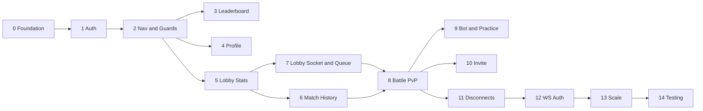

# Miwa — Vertical Slice Roadmap (Teacher's Guide)

> **Who writes the code?** You do. This document never gives you code. It tells you **what to learn**, **what to build and why**, and **how to prove it works**, slice by slice.
> **Source of truth:** `REQUIREMENTS.md`. Every slice below says which requirement section(s) it closes.
> **Replaces / extends:** `frontend/miwaFrontend.md` (that was the plain-HTML Task 1 guide. This one is the React + backend-fixes guide).

---

## 0. How to Use This Guide

1. **Do the slices in order.** Each one builds on the one before it (see the dependency map in §2).
2. **A vertical slice is done only when it works end to end.** That means the database, FastAPI, React and a browser test all pass. A page with nothing behind it isn't done, and neither is an endpoint with no page.
3. Every slice has three parts:
   - **A. Prerequisite knowledge.** Study these before you touch the code. If you can't explain a concept out loud in two sentences, read about it again.
   - **B. Work to do.** The backend fixes first, then the frontend. Read the *why* behind each item, not just the *what*.
   - **C. Test methodology.** A checklist of things to observe. Copy it into your commit message or PR description and tick it off.
4. **One slice = one git branch = one or more commits.** Name branches like `slice-01-auth`. Merge into `main` only after part C passes.
5. **Keep a learning log.** After each slice, write 5 lines in a `docs/learning_log.md`: what you learned, what broke, how you fixed it. It's useful for both your JS and OOP classes.
6. When you get stuck, come back to me with: *what you tried, what you expected, what actually happened (error text or screenshot).* I'll guide you with questions and hints, not code.

---

## 1. Current State Audit (What I Found in the Codebase)

You need an honest picture before planning. Here's what exists and what's broken.

### 1.1 Frontend (`frontend/`)
| Item | State | Problem |
| :--- | :--- | :--- |
| Vite + React 19 + **TypeScript** scaffold | ✅ Exists | `App.tsx` is still the Vite demo page. |
| `frontend/index.html` | ⚠️ Broken | It mixes your Task-1 static HTML with the React entry. It has **no `
`**, so `main.tsx` crashes (`document.getElementById('root')!` is null). It links a `styles.css` that doesn't exist. `#hero-view` appears as visible text. |
| `react-router-dom` | ❌ Missing | Not in `package.json`. |
| Pages / components / hooks from REQUIREMENTS §4 | ❌ None exist | |

> [!NOTE]
> Your project uses **TypeScript** (`.tsx`). That's fine for a JS class, because TS is JS with types. If your professor requires plain JS, ask now, before Slice 0, since switching later is painful. The rest of this guide assumes TS and points out where types help.

### 1.2 Backend bugs and gaps (mapped to REQUIREMENTS §5)
| # | Where | Problem | Fixed in Slice |
| :--- | :--- | :--- | :--- |
| 1 | `app/main.py` | No `CORSMiddleware`, so the browser blocks React → API calls (§5.3.1). | 0 |
| 2 | `app/routes/auth.py` | Login cookie has no `max_age` / `samesite`. **No `/api/logout`** (§3.1). | 1 |
| 3 | `app/services/auth_service.py` | Only the email is checked for duplicates. A duplicate username gives a 500 `IntegrityError` (§5.3.4). | 1 |
| 4 | `app/routes/user.py` → `get_leaderboard` | No `response_model`, so **`password_hash` and `email` of the top 20 players leak** (§5.3.2). | 3 |
| 5 | `app/routes/user.py` → PUT/DELETE | Returns `404` instead of `403` for cross-user edits (§5.3.5). DELETE leaves the player's `sessions` rows behind (§3.1). | 4 |
| 6 | `app/schemas/user.py` → `UserUpdate` | `username` has no `default=None` (§5.3.5). | 4 |
| 7 | `app/models/match.py` | No `created_at`, `category`, or per-player ELO delta columns, so **match history (§3.2) can't be built**. No endpoint `/api/user/{id}/matches`. | 6 |
| 8 | `app/global_manager.py`, `app/room_manager.py` | `disconnect` deletes by `player_id` without checking it's the *same socket*. With React StrictMode (double-mounting in dev) or a page refresh, the **new** socket gets removed and `match_found` is silently lost. | 7 |
| 9 | `app/services/matchmaking_service.py` | Head-of-line blocking in `try_pair()` (§5.2.1). Tick is 10 s instead of 2 s. | 7 |
| 10 | `app/services/game_service.py` | Self-cancelling timer (§5.2.2). `question_start` has no `image`, total count, or duration. `match_ended` payload shape differs per branch (`progress` is sometimes a string `"+16"`, sometimes an int `0`). | 8 |
| 11 | `app/routes/ws.py` | `submit_answer` before the game exists causes a `KeyError` that kills the socket. Only `WebSocketDisconnect` is caught. | 8 |
| 12 | `app/routes/matches.py` → `switch_to_bot`, `bot_service.py` | Bot ID stored in `player2_id` (collision). `advice_data=None` raises a `TypeError`. The advice message has **no `event` key**, so the frontend can't route it. Practice mode can't reach a bot without first joining the ranked queue. Bot matches saved as `RANKED` (§5.2.4). | 9 |
| 13 | `app/services/match_service.py`, `matches.py` | Invite matches have `questions_data=None`, which crashes `GameService`. No category. Player 1 isn't notified. Anyone can "join" an already-full room (§5.2.5). | 10 |
| 14 | `app/routes/ws.py`, `game_service.py` | Abandoned matches stay `IN_PROGRESS` forever, blocking the player from queueing again (§5.2.3). | 11 |
| 15 | `app/routes/ws.py` | WebSockets trust the `player_id` in the URL, so anyone can impersonate (§5.3.3). | 12 |
| 16 | `app/database.py` | `NullPool` + `echo=True`. Sync DB calls inside `async def` (§5.1). | 13 |
| 17 | Repo root | **No `requirements.txt`**. Nobody (not your professor, not CI, not you on a new laptop) can reproduce the backend environment. | 0 |
| 18 | `app/services/run_mm_service.py` | The matchmaking loop has **no `try/except`**. One exception (sending `match_found` to a dead socket, a DB hiccup) kills the background task **silently, and matchmaking stops for everyone until the server restarts**. | 7 |
| 19 | `app/room_manager.py` → `send_to`, `app/global_manager.py` | `send_to`/`send_json` aren't protected (only `broadcast` is). Sending to a closed socket inside `_end_match` raises *before* `del active_games[...]`, so the game leaks in memory and the second player never gets `match_ended`. | 8 |
| 20 | `app/routes/matches.py` → `GET /api/match/{id}` | Unauthenticated, no `response_model`. Anyone can read any match's players, `questions_data` and `answers_data`. | 8 |
| 21 | `app/services/game_service.py` → `__init__` | If a category has fewer than 10 questions (or 0), or a question was deleted, `questions_map[qid]` / `self.questions[index]` raise and the match crashes at start. | 8 / 9 |
| 22 | `app/routes/matches.py` → `/api/matchmaking/join` "2nd guard" | It only checks `IN_PROGRESS` matches, so a player who is sitting on a `WAITING` invite (or whose bot match stored the bot in `player2_id`) can still queue. | 7 / 10 |
| 23 | `game_service.py`, `ws.py` | `asyncio.get_event_loop()` is deprecated inside coroutines. Use `get_running_loop()`. (Minor, but it'll print warnings on newer Python.) | 8 |
| 24 | `app/services/auth_service.py`, `app/core/dependencies.py` | Login says *which* part was wrong ("username doesn't exist" vs. "wrong password"), so attackers can discover valid usernames. Expired session rows are never cleaned up. No rate limit on `/api/login`. (Low priority, but good to mention in your report.) | 1 / 13 |
| 25 | `.github/workflows` → `ARCHITECTURE.md` | The UML action fails (Graphviz not installed on the runner), so the frontend diagram is an error message. | 14 |

---

## 2. Slice Map

| Phase | Slice | Feature | Backend work | Frontend work |
| :--- | :--- | :--- | :--- | :--- |
| **1 – Finished endpoints get pages** | 0 | Foundation & app shell | CORS | Router, layout, API client, CSS migration |
| | 1 | Authentication | Logout, duplicate username, cookie flags | `AuthContext`, `AuthPage`, `AuthForm` |
| | 2 | Navigation, Home & route guarding | – | `Navbar`, `Hero`, `HomePage`, `ProtectedRoute` |
| | 3 | Leaderboard | Leaderboard schema (data leak) | `LeaderboardPage` |
| | 4 | Profile & account settings | 403s, `UserUpdate`, session cleanup | `ProfilePage`, confirm modal |
| | 5 | Lobby dashboard stats | (optional win-rate field) | `LobbyPage` shell, `StatsGrid` |
| | 6 | Match history | New columns + new endpoint | `MatchHistoryTable` |
| **2 – Real-time** | 7 | Lobby socket & ranked queue | Socket identity fix, matchmaking rewrite | `useLobbySocket`, `MatchmakingPanel` (Ranked) |
| | 8 | Live battle (PvP) | Game loop fixes, event contract | `useBattleSocket`, `BattlePage` + children |
| | 9 | Ghost bot & Practice | Bot fixes, practice entry | `BotOfferModal`, `BotAdviceBanner`, Practice tab |
| | 10 | Invite matches | Category, questions, notify P1 | Invite tab |
| | 11 | Disconnects & forfeits | Grace timer, forfeit, cleanup | Reconnect UX |
| | 12 | WebSocket authentication | Cookie check on WS | (none, just verify) |
| **3 – Production** | 13 | Scale: DB pool & event loop | Pool, `to_thread`, bcrypt rounds | – |
| | 14 | Automated & load testing | pytest, Locust | Vitest + React Testing Library |

---

# PHASE 1 — Give the Finished Endpoints a Face

---

## Slice 0 — Foundation & App Shell

**Closes:** REQUIREMENTS §4 (SPA architecture), §5.3.1 (CORS).
**Goal:** An empty but correctly structured React SPA. It has routing, a shared layout, one place that talks to the API, and a backend that accepts its requests.

### A. Prerequisite Knowledge
1. **How a Vite React app boots:** `index.html` → `
` → `main.tsx` → `createRoot().render(<App/>)`. Learn why the HTML file is now almost empty.
2. **JSX rules:** `className` instead of `class`, `htmlFor` instead of `for`, self-closing tags, one parent element per return, Fragments (`<>…</>`), and `{}` for JS expressions.
3. **Components and props:** function components, passing data down, `children` prop. Read react.dev → *Learn* → "Describing the UI".
4. **Client-side routing with React Router (v6/v7 "library mode"):** `BrowserRouter`, `Routes`, `Route`, nested routes, `Outlet` (for a shared layout), `Link` / `NavLink`, `useNavigate`, `useParams`, `Navigate`. Understand how routing differs from your Task-1 `switchView()` approach.
5. **`fetch` + `async/await` + `try/catch`**, and HTTP status codes (200, 400, 401, 403, 404, 422, 500). Learn that `fetch` does **not** throw on 4xx/5xx; you have to check `response.ok`.
6. **CORS & cookies:** what an *origin* is (scheme + host + port), why `localhost:5173` → `localhost:8000` is *cross-origin* but *same-site*, what `credentials: "include"` does, and why `allow_origins=["*"]` can't be combined with `allow_credentials=True`.
7. **Environment variables in Vite:** `import.meta.env`, the `VITE_` prefix, `.env.local`.
8. **CSS Modules vs. global CSS:** files named `X.module.css` and how class names become scoped. Also CSS custom properties (`:root` variables), which you already planned in `miwaFrontend.md`.
9. **TypeScript basics for React:** `interface` / `type` for props and API responses, typing `useState`, union types.

### B. Work To Do

**Backend**
1. In `app/main.py`, register FastAPI's `CORSMiddleware` **before** including routers. Allowed origin: `http://localhost:5173` (and a placeholder for production). Set `allow_credentials=True` and allow all methods and headers.
2. Decide on **one hostname**. Always open the app at `http://localhost:5173` and run the API at `http://localhost:8000`. Never mix it with `127.0.0.1`, because cookies are stored per host and a mix-up looks like "login works but I'm logged out instantly".
3. *(Optional, but good hygiene)* Set `echo=False` in `app/database.py` so your terminal stays readable. (The full DB work is in Slice 13.)
4. **Create `requirements.txt`** from your venv (learn what `pip freeze` produces, and trim it to the packages you actually import: fastapi, uvicorn, sqlalchemy, psycopg2-binary, passlib/bcrypt, pydantic[email], python-dotenv, pytz). Test it by creating a fresh venv and installing from the file.

**Frontend**
1. **Fix `index.html`:** remove all Task-1 markup and the `styles.css` link. Keep only the head metadata, a single root div, and the module script. Your old markup isn't wasted: you'll move its pieces into JSX components in Slices 1–2.
2. **Clean the scaffold:** delete the Vite demo content from `App.tsx` and `App.css`, and the demo assets you won't use.
3. **Install `react-router-dom`** with npm.
4. **Create the folder structure** (a suggested layout; justify any change you make):
   - `src/api/` holds the single API client module plus one module per backend domain (auth, users, matches).
   - `src/context/` holds `AuthContext` (Slice 1).
   - `src/hooks/` holds `useLobbySocket`, `useBattleSocket` (Phase 2).
   - `src/pages/` holds one folder per page from REQUIREMENTS §4.1.
   - `src/components/` holds reusable pieces (`Navbar`, `Modal`, `Spinner`, `ErrorBanner`…).
   - `src/types/` holds TS interfaces mirroring your Pydantic schemas (`UserResponse`, `UserStats`, …).
   - `src/styles/` holds global variables and the reset.
5. **Create `.env.local`** with a `VITE_API_URL` variable pointing to the backend. Also derive a WebSocket base URL from it (http → ws). Add `.env.local` to `.gitignore`.
6. **Write the API client** (one small module, the most important file in Phase 1). It should:
   - Prefix every path with `VITE_API_URL`.
   - **Always** send `credentials: "include"`.
   - Set JSON headers and stringify bodies.
   - Check `response.ok`. If it's false, read the JSON body and throw an error that carries both the **status code** and FastAPI's `detail` message. Note that `422` errors have `detail` as an *array* of validation errors, not a string, so handle both shapes.
   - Return the parsed JSON on success.
   *Why:* every page calls the backend. If cookie handling and error parsing live in one place, you fix bugs once.
7. **Mirror your schemas as TS types** in `src/types/`: `UserResponse`, `UserStats`, `LoginRequest`, `UserRegister`, `UserUpdate`. Keep the field names **identical** to Pydantic (snake_case like `total_matches`). Don't rename them in the frontend.
8. **Define all routes in `App.tsx`** with placeholder pages ("Lobby coming soon"): `/`, `/auth`, `/lobby`, `/battle/:matchId`, `/leaderboard`, `/profile`, and a `*` catch-all "404" page. Wrap them in a **layout route** whose element renders the (future) `Navbar` and an `Outlet`.
9. **Global CSS:** move the `:root` variables, reset, `.hidden`, `.elo-gain`/`.elo-loss` and button classes you designed in `miwaFrontend.md` into `src/styles/global.css` (imported once in `main.tsx`). Use CSS Modules for page-specific styles.

### C. Test Methodology
| # | Test | Expected |
| :--- | :--- | :--- |
| 1 | `npm run dev`, open `http://localhost:5173` | No blank page, no red errors in DevTools Console. |
| 2 | Visit each route manually by typing it in the URL bar | The matching placeholder renders. The `Navbar` area stays. An unknown URL shows your 404 page. |
| 3 | Temporarily call `GET /health` through your API client from a component and log it | DevTools → Network shows the request to `:8000` with status 200. No CORS error in Console. |
| 4 | Check the **response headers** of that request | `access-control-allow-origin: http://localhost:5173` and `access-control-allow-credentials: true`. |
| 5 | Temporarily call `GET /api/user/me` (not logged in) | Your client throws an error object with `status === 401` and the message `"Not authenticated"`, shown in Console. |
| 6 | `npm run build` and `npm run lint` | Both succeed (the TS compiler is happy). |

**Done when:** all 6 pass, and you've removed the temporary test calls.

---

## Slice 1 — Authentication (Register, Login, Logout, Session Restore)

**Closes:** §3.1 (register, login, logout), §4.1.2 (`AuthPage`), §4.2 (`AuthContext`), §5.3.4, §6.1 "Auth & Sessions".

### A. Prerequisite Knowledge
1. **`useState`** and **controlled inputs** (`value` + `onChange`). Why React should own the input value.
2. **Form handling in React:** `onSubmit`, `event.preventDefault()`, disabling the submit button while a request is in flight.
3. **`useEffect`:** dependency arrays, running once on mount, and why an effect **cannot be `async` directly** (define an async function inside it and call it).
4. **Context API:** `createContext`, a Provider component, a custom hook `useAuth()` that calls `useContext` and throws if used outside the provider.
5. **Session cookies vs. tokens:** your backend uses a **stateful session** (`sessions` table + `HttpOnly` cookie). Understand why JS **can't read** an `HttpOnly` cookie. That's the reason the frontend learns "am I logged in?" by calling `GET /api/user/me`.
6. **Cookie attributes:** `HttpOnly`, `Max-Age`, `SameSite` (`lax`/`strict`/`none`), `Secure`. Know what happens to a cookie *without* `Max-Age` when the browser closes.
7. **Client-side validation vs. server-side validation:** mirror the Pydantic rules (username 5–50, valid email, password ≥ 8) in the form for UX, but the server stays the authority.
8. **SQL uniqueness & `IntegrityError`:** why checking before insert is good UX, and why the DB constraint is still the final guard.

### B. Work To Do

**Backend**
1. **Duplicate username check** (`AuthService.register`): query for a player whose email **or** username matches. Return `400` with a message that tells the user *which* field is taken. (Two separate queries give a better message than one combined query. Think about which you prefer.)
2. **Cookie flags** (`/api/login`): add `max_age` = 24 hours (matching `expires_at` in the session row) and `samesite="lax"`. Leave a comment that `secure=True` is required in production (HTTPS).
3. **Login response:** right now it returns only a message. Return the **user object** (`UserResponse`) too, so the frontend doesn't need a second request after logging in. Think about whether `response_model` should change.
4. **New endpoint `POST /api/logout`:** read the `session_id` cookie, delete that row from `sessions` (if it exists), clear the cookie with `delete_cookie` (same key and path as when it was set), and return a success message. It should **not** fail if the user is already logged out. Logout must always work.
5. *(Small note)* `/api/user/me` currently lives in `auth.py` and works only because `auth.router` is included **before** `user.router` (otherwise `/api/user/{user_id}` would try to parse `"me"` as an int and return 422). Either move it into `user.py` *above* the `{user_id}` route, or leave a comment explaining the ordering dependency.

**Frontend**
1. **`api/auth` module:** functions `register`, `login`, `logout`, `getMe`, all built on your Slice-0 client.
2. **`AuthContext` + `AuthProvider`:**
   - State: `currentUser` (user object or `null`) and `isLoading` (true until the first `getMe` finishes).
   - On mount: call `getMe`. On success set the user. On `401` set `null` (that's not an error, just "logged out"). Always set `isLoading` to false at the end.
   - Expose `login(credentials)`, `register(data)`, `logout()` and a `refreshUser()` (Slice 4 and Phase 2 need it after the ELO changes).
   - Decide what `register` does after success. REQUIREMENTS says *redirect to `/lobby` after authentication*, but your register endpoint doesn't log the user in. Two options: (a) call `login` automatically after a successful register, or (b) switch the form to Sign In mode with a success message. Choose one and write down why.
   - Wrap `<App/>` (or the router) in the provider in `main.tsx`.
3. **`AuthPage` + `AuthForm`** (convert your Task-1 auth card into JSX):
   - A `mode` state: `"login" | "register"`. The title, button text and toggle link text depend on it. The email field renders **only** in register mode (conditional rendering, not CSS hiding).
   - One state object or separate states for username, email and password. All inputs are controlled.
   - Client-side validation before sending. Show field-level messages.
   - `isSubmitting` state disables the button and shows "Signing in…".
   - An **error banner** showing the server's `detail` (e.g. "Wrong password", "username taken").
   - On success, `navigate("/lobby")`.
   - If the user is **already logged in** and visits `/auth`, redirect them to `/lobby`.
4. **Fix the labels:** in your Task-1 HTML, `label for` pointed at the wrong id (`username-group`) and one class was misspelled `from-group`. Make sure every `htmlFor` matches its input's `id` (accessibility, and clicking a label focuses its input).

### C. Test Methodology
**API level first** (use Swagger at `http://localhost:8000/docs`, or `curl` with a cookie jar: `-c` saves cookies, `-b` sends them):
| # | Test | Expected |
| :--- | :--- | :--- |
| 1 | Register a valid new user | `200`, body has `id, username, email, elo`. **No `password_hash`.** |
| 2 | Register again with the same **email** | `400` with an email-taken message. |
| 3 | Register with a new email but the same **username** | `400` with a username-taken message (**not 500**). |
| 4 | Register with a 3-character username / 5-character password | `422`. |
| 5 | Login with valid credentials | `200`, a `Set-Cookie` header with `session_id`, `HttpOnly`, `Max-Age=86400`, `SameSite=lax`. |
| 6 | Login with a wrong password / unknown username | `401`. |
| 7 | `GET /api/user/me` with the cookie / without it / with a tampered value | `200` / `401` / `401`. |
| 8 | `POST /api/logout`, then `GET /api/user/me` with the old cookie | Logout `200`. `/me` → `401`. The row is gone from the `sessions` table (check in Supabase). |
| 9 | Call logout twice | Both succeed. |

**Browser level:**
| # | Test | Expected |
| :--- | :--- | :--- |
| 10 | Toggle Login ↔ Register | The email field appears and disappears, and the title and button text change. No page reload. |
| 11 | Submit an invalid form | Field messages appear. **No network request** in DevTools. |
| 12 | Submit valid login | The button is disabled during the request, then you're redirected to `/lobby`. DevTools → Application → Cookies shows `session_id` (you can see it there but JS can't read it: try `document.cookie` in the Console). |
| 13 | **Refresh the page** on `/lobby` | You stay logged in (the context restores you from `/api/user/me`). No flicker to the login page. |
| 14 | Close and reopen the browser | Still logged in (thanks to `Max-Age`). |
| 15 | Wrong password | A red banner with the server message. The form keeps the typed username. |

---

## Slice 2 — Navigation, Home Page & Protected Routes

**Closes:** §4.1.1 (`HomePage`, `Navbar`, `Hero`), §6.1 "React Frontend" test 2 (protected routes redirect).

### A. Prerequisite Knowledge
1. **Conditional rendering:** `&&`, ternaries, and early `return`.
2. **`NavLink`** and its active-class behaviour (this replaces your Task-1 manual `.active` toggling).
3. **Wrapper / guard components:** a component that renders `children` (or an `Outlet`) only if a condition holds, otherwise `<Navigate to=… replace />`. Understand what `replace` does to browser history.
4. **The "loading" state problem:** why a guard must wait for `isLoading` to become false before deciding to redirect, and what bug you get if it doesn't.
5. **`useLocation`** and passing `state` through navigation (to send the user back to the page they originally wanted after logging in).
6. **Responsive layout with Flexbox** (navbar) and **CSS Grid** (hero, cards). Media queries.

### B. Work To Do
1. **`Navbar` component:** brand logo (from Task 1), `NavLink`s to Home, Lobby, Leaderboard, Profile. On the right, show **Login / Register** if `currentUser` is null, otherwise the username, current ELO and a **Logout** button. Logout calls the context's `logout()` and navigates to `/`.
2. **`Hero` component:** headline, value proposition (ОРТ, 1v1, Math / Grammar / Vocabulary), two CTAs:
   - "Play 1v1 Now" goes to `/lobby` (the guard handles unauthenticated users).
   - "Create Account" goes to `/auth` **in register mode**. Think about how to tell `AuthPage` which mode to open in. Options: a query string (`/auth?mode=register`) or navigation `state`. Pick one.
3. **`HomePage`:** composes `Hero` plus optionally three small "category" cards explaining the subjects.
4. **`ProtectedRoute`:** reads `useAuth()`. While `isLoading`, render a spinner. If not logged in, redirect to `/auth` and remember the attempted location. Otherwise render the protected content. Apply it to `/lobby`, `/battle/:matchId` and `/profile` (§4.1). Decide whether `/leaderboard` is public (REQUIREMENTS doesn't mark it protected, so public is reasonable).
5. **Return-to after login:** in `AuthPage`, after success navigate to the remembered location if there is one, else `/lobby`.

### C. Test Methodology
| # | Test | Expected |
| :--- | :--- | :--- |
| 1 | Logged out, type `/lobby` in the URL bar | Redirected to `/auth`. After login you land back on `/lobby`. |
| 2 | Logged out, type `/battle/123` | Redirected to `/auth`. After login you return to `/battle/123`. |
| 3 | Logged in, refresh `/profile` | You stay on `/profile`. **No** brief redirect to `/auth` (watch closely, or throttle the network to "Slow 3G" in DevTools to make a race visible). |
| 4 | Navbar when logged out vs. in | Correct links and buttons. The active link is highlighted. |
| 5 | Press browser Back after a guard redirect | You don't bounce into a redirect loop (that's what `replace` is for). |
| 6 | "Create Account" CTA | Opens `/auth` already in register mode. |
| 7 | Resize to phone width | The navbar and hero stay usable, with no horizontal scrollbar. |

---

## Slice 3 — Leaderboard

**Closes:** §3.2 (leaderboard), §4.1.5, §5.3.2 (data leak), §6.1 "User & Leaderboard".

### A. Prerequisite Knowledge
1. **Pydantic `response_model`:** how FastAPI *filters* output fields, and why returning raw ORM objects without it is dangerous. Look at what `GET /api/leaderboard` returns **right now** in Swagger. That's your motivation.
2. **Pydantic `from_attributes`** (ORM mode) and `list[Schema]` response models.
3. **Rendering lists in React:** `.map()`, why `key` must be stable and unique (use `id`, not the array index), and what goes wrong otherwise.
4. **The data-fetching pattern:** `useEffect` + three states (`data`, `isLoading`, `error`), plus a cleanup flag (or `AbortController`) so a late response doesn't update an unmounted component.
5. **Semantic tables:** `<table>`, `<thead>`, `<tbody>`, `<th scope="col">`.

### B. Work To Do

**Backend**
1. Create a `LeaderboardEntry` schema in `app/schemas/user.py`: `id`, `username`, `elo`, `wins`, `total_matches` (exactly the columns from §4.1.5). **No email, no hash.**
2. Put `response_model=list[LeaderboardEntry]` on `GET /api/leaderboard`.
3. Ask yourself: should `GET /api/user/{user_id}` (public, unauthenticated) expose another user's **email**? Probably not. Consider a `PublicUser` schema for it, and keep `UserResponse` (with email) for `/api/user/me`.

**Frontend**
1. `api/users` module: `getLeaderboard()`.
2. `LeaderboardPage`: a table with Rank, Username, ELO, Wins, Total Matches, plus a computed column for Win Rate if you like. Rank is the position in the array + 1, since the backend already sorts by ELO.
3. Highlight the **current user's row** if present (compare `id` with `currentUser.id`).
4. Show loading, error and empty states ("No players yet").

### C. Test Methodology
| # | Test | Expected |
| :--- | :--- | :--- |
| 1 | `GET /api/leaderboard` in Swagger | An array of at most 20 items with **only** the 5 fields. Search the raw response for `password` and `email`: 0 matches. |
| 2 | Compare with Supabase `players` ordered by `elo desc` | Same order, same top 20. |
| 3 | Open `/leaderboard` logged out and logged in | Works both times. Your row is highlighted when logged in. |
| 4 | Stop the backend, reload the page | A friendly error banner, not a white screen. |
| 5 | DevTools Console | No "each child in a list should have a unique key" warning. |
| 6 | Navigate away quickly while it's loading (throttle the network) | No "state update on unmounted component" style errors. |

---

## Slice 4 — Profile & Account Settings

**Closes:** §3.1 (view/edit profile, delete account), §4.1.5 (settings form, logout, delete confirm modal), §5.3.5, §6.1 "User & Leaderboard" test 3.

### A. Prerequisite Knowledge
1. **REST semantics:** PUT vs. PATCH, and why `exclude_unset=True` matters for partial updates.
2. **401 vs. 403 vs. 404:** "who are you?" vs. "I know who you are, and you're not allowed" vs. "doesn't exist". Why returning 404 for authorization failures is sometimes done deliberately (hiding existence), and why your spec still wants 403.
3. **Pydantic optional fields:** the difference between `Optional[str]` and `Optional[str] = None`, and what "required but nullable" means in Pydantic v2.
4. **Modals in React:** conditional rendering of an overlay, closing on Escape and on backdrop click, focus management basics. Optional: `createPortal`.
5. **Destructive-action UX:** confirmation that requires an explicit action (e.g. typing your username).
6. **Lifting state up / updating context after a mutation**, so the Navbar shows the new username instantly.

### B. Work To Do

**Backend**
1. `UserUpdate.username`: give it `default=None` while keeping the length constraints.
2. PUT and DELETE `/api/user/{user_id}`: return **403** when `current_user.id != user_id`.
3. PUT: if the new username is already taken by **another** player, return `400` (the same reasoning as Slice 1, otherwise you get a 500 `IntegrityError`).
4. DELETE: also delete every `sessions` row for that player (§3.1 "delete … and active sessions"), and clear the cookie in the response.
5. Think and decide: what happens to `matches` rows where this player appears? (Keep them for the opponent's history. Your history endpoint in Slice 6 must then handle a missing opponent and show "Deleted user".) Write the decision in a comment.

**Frontend**
1. `api/users`: `updateUser(id, data)`, `deleteUser(id)`.
2. `ProfilePage` with three cards:
   - **Profile info:** username, email, ELO, member since (needs `created_at` in the schema if you want it).
   - **Update username form:** controlled input pre-filled with the current username. Validation 5–50 characters. Disable Save if unchanged. On success call `refreshUser()` (or update the context directly) and show a success toast or message.
   - **Danger zone:** a Logout button and a Delete Account button that opens a **`ConfirmModal`** (make it a reusable component in `src/components/`; you'll reuse it in Phase 2). On confirm: call delete, clear the context user, navigate to `/`.

### C. Test Methodology
| # | Test | Expected |
| :--- | :--- | :--- |
| 1 | Swagger: as user A, PUT `/api/user/{B's id}` | **403**. |
| 2 | Swagger: as user A, DELETE `/api/user/{B's id}` | **403**, and B still exists. |
| 3 | PUT with an empty body `{}` | `200`, nothing changes (no 422). |
| 4 | PUT with a username owned by someone else | `400`. |
| 5 | Browser: change username | The Navbar updates immediately. After a refresh the new name persists. |
| 6 | Browser: delete account → cancel | Nothing happens. |
| 7 | Browser: delete account → confirm | Redirected to Home, logged out. In Supabase: the player row is gone, **0 rows** in `sessions` for that `player_id`. Logging in with the old credentials → `401`. |

---

## Slice 5 — Lobby Dashboard: Stats Grid

**Closes:** §3.2 (personal dashboard), §4.1.3 `StatsGrid`.

### A. Prerequisite Knowledge
1. **Derived state:** win rate and division are **computed during render** from fetched data, not stored in their own `useState`. Learn why duplicating state causes bugs.
2. **Division by zero and number formatting** in JS (`toFixed`, `Intl.NumberFormat`).
3. **Component composition:** `LobbyPage` = `StatsGrid` + `MatchmakingPanel` + `MatchHistoryTable`. Each fetches its own data, or the page fetches and passes props down. Know the trade-offs.
4. **CSS Grid `auto-fit` + `minmax`** (already in your Task-1 plan).

### B. Work To Do

**Backend (optional)**
- `UserStats` has `elo, wins, streak, total_matches`. You can compute the win rate on the frontend, or add a computed `win_rate` field in the schema. Pick one place and keep it there. Don't compute it in both.

**Frontend**
1. `LobbyPage` layout with three regions. For now `MatchmakingPanel` and `MatchHistoryTable` are placeholders.
2. `StatsGrid` fetches `GET /api/user/{currentUser.id}/stats` and renders **four** `StatCard`s (a reusable component taking `title`, `value` and an optional badge): Current ELO + Division badge, Matches Played, Win Rate %, Current Streak.
3. **Division badge:** REQUIREMENTS doesn't define thresholds. **You** decide the ELO bands (note that the default ELO is 110, not 1200 like in your Task-1 mock) and put them in one constants file, so changing them later is trivial. Give each division a color.
4. Re-fetch stats when returning to the lobby after a match (Phase 2 will rely on this). Using `useEffect` on mount is enough, because the page remounts when you navigate back.

### C. Test Methodology
| # | Test | Expected |
| :--- | :--- | :--- |
| 1 | A fresh user (0 matches) | ELO 110, Matches 0, Win Rate shows `0%` or `—`, **not `NaN%`** or `Infinity`. |
| 2 | Edit a player in Supabase (e.g. wins = 3, total_matches = 4, elo = 180), refresh the lobby | 75% win rate, correct division badge for 180. |
| 3 | Check DevTools Network | Exactly one stats request per lobby visit (in production build; in dev StrictMode you may see two, so explain why in your learning log). |
| 4 | Phone width | Cards stack into one column. |

---

## Slice 6 — Match History

**Closes:** §3.2 (match history), §4.1.3 `MatchHistoryTable`.
This is the first slice where the **backend endpoint doesn't exist yet**, so it's a true full vertical.

### A. Prerequisite Knowledge
1. **Schema evolution:** `Base.metadata.create_all()` creates *missing tables* but **never alters existing ones**. Learn two ways to add columns: (a) an `ALTER TABLE … ADD COLUMN` in the Supabase SQL editor, keeping your model in sync by hand, or (b) **Alembic** migrations (the professional way. Optional, but a big plus for your OOP class).
2. **SQLAlchemy queries:** filtering with OR (`player1_id == x | player2_id == x`), `order_by(desc)`, `limit`, and fetching related names efficiently. Avoid the **N+1 query problem**: collect all opponent IDs first, then fetch them in **one** `IN (...)` query.
3. **Server-side timestamps:** `server_default=func.now()` vs. setting time in Python. Timezone-aware datetimes.
4. **Designing a response schema for the UI** (a "view model"): the endpoint should return exactly what the table shows, already resolved *from the requesting player's perspective* (my score vs. opponent score, my ELO change).
5. **Date formatting in JS:** `Intl.DateTimeFormat` / `toLocaleDateString`.

### B. Work To Do

**Backend**
1. **Add columns to `Match`** (model + real DB): `created_at`, `finished_at`, `category`, `player1_elo_change`, `player2_elo_change` (all nullable for old rows).
2. **Fill them where matches are born and die** (you'll touch these files again in Phase 2, so leave clear TODOs if you can't finish now):
   - `category` when creating the match in `run_mm_service.py`, `switch_to_bot` and (in Slice 10) the invite.
   - `finished_at` + both ELO changes in `GameService._end_match` (0 for bot matches and draws).
3. **New schema `MatchHistoryEntry`:** `match_id`, `date`, `opponent_name`, `opponent_is_bot`, `category`, `mode`, `my_score`, `opponent_score`, `result` (`"win" | "loss" | "draw"`), `elo_change`.
4. **New endpoint `GET /api/user/{user_id}/matches`** with an optional `limit` (default 10–20):
   - Only `COMPLETED` matches where the user is player1 or player2, newest first.
   - For each row, work out "me" vs. "opponent". Resolve the opponent's name from `players`, or from `bots` when `player2_bot_id` is set (after Slice 9), or "Deleted user" if not found.
   - Decide on authorization: public, or only the owner? Write your choice in a docstring.
5. Since real completed matches don't exist yet, **seed 3–5 fake completed matches** directly in Supabase (or with a small throwaway script you write) to develop against. Delete them later.

**Frontend**
1. `api/matches`: `getMatchHistory(userId)`.
2. `MatchHistoryTable`: columns Date, Opponent, Category, Score (`7 – 5`), Result (colored pill), ELO Change (`.elo-gain` / `.elo-loss`, with an explicit `+` sign for positive). Show a bot icon or tag next to bot opponents.
3. A filter (All / Wins / Losses) from your Task-1 plan. That's derived state again: filter during render, don't refetch.
4. Empty state: "No matches yet — play your first battle!" with a button that scrolls to the matchmaking panel.

### C. Test Methodology
| # | Test | Expected |
| :--- | :--- | :--- |
| 1 | Swagger `GET /api/user/{id}/matches` for a user with seeded matches | Correct perspective: when the user was `player2`, `my_score` is `player2_score`. Results and ELO signs match. |
| 2 | Newest first, `limit` respected | ✔ |
| 3 | A user with 0 matches | `[]` with `200`, not 404. |
| 4 | Watch the uvicorn log (`echo=True` temporarily) | A constant number of SQL queries regardless of how many matches (no N+1). |
| 5 | Browser: filter Wins / Losses | Instant. No new network request. |
| 6 | Opponent deleted (delete a seeded opponent) | The row shows "Deleted user", no 500. |

---

# PHASE 2 — Real-Time: WebSockets & In-Game State

> [!IMPORTANT]
> Before Slice 7, read the whole of `app/routes/ws.py`, `app/global_manager.py`, `app/room_manager.py`, `app/services/game_service.py` and `app/services/bot_service.py` again, and **draw the event sequence on paper** (who sends what, when). You'll understand Phase 2 far better than by reading this guide alone.

### Phase 2 shared knowledge (learn once, use in Slices 7–12)
1. **The WebSocket protocol:** handshake (HTTP Upgrade), `readyState` values (CONNECTING/OPEN/CLOSING/CLOSED), `onopen`/`onmessage`/`onclose`/`onerror`, close codes (1000 normal, 1006 abnormal, 1008 policy violation, 4000–4999 app-defined).
2. **The browser `WebSocket` API:** sending JSON (`JSON.stringify`), parsing (`JSON.parse`), and why you can't send before `onopen`.
3. **`useRef`:** storing the socket instance across renders *without* causing re-renders.
4. **`useEffect` cleanup and React StrictMode:** in development, React **mounts, unmounts and remounts** every component once, so your socket opens, closes and opens again. Your hook must close the socket in the cleanup. Your **server** must survive this (see Slice 7, backend item 1).
5. **Stale closures:** an `onmessage` handler created on the first render sees the *first render's* state forever. The cures are functional state updates, `useReducer`, or refs. This is the #1 WebSocket bug in React.
6. **`useReducer`:** model battle state as `(state, action) → newState`. Each server event becomes an action. This makes the battle logic testable without a browser.
7. **TS discriminated unions:** type every server message as a union keyed by `event`, so a `switch(msg.event)` is type-safe.
8. **Python asyncio basics:** `async/await`, `asyncio.create_task`, `asyncio.sleep`, task cancellation (`CancelledError`), and that **one blocking call freezes every connection**.
9. **The tool you already have:** `./websocat` in the repo root is a CLI WebSocket client. Learn to connect with it to `ws://localhost:8000/ws/...` and type JSON by hand. It lets you test the backend without React. (After Slice 12 it needs a cookie header; check its `-H` option.)

---

## Slice 7 — Lobby Socket & Ranked Queue

**Closes:** §3.3 (join and cancel the ranked queue), §4.1.3 `MatchmakingPanel` (Ranked tab, queue bar with timer, Cancel), §4.2 `useLobbySocket`, §5.2.1 (head-of-line blocking), §6.1 "Matchmaking Pool".

### A. Prerequisite Knowledge
- Phase 2 shared knowledge, items 1–5 and 8.
- **Algorithm:** grouping (a dict of lists), sorting by key, scanning adjacent pairs, and why sorting by ELO and checking *neighbours* finds valid pairs in O(N log N). Think about whether a greedy adjacent sweep is "optimal" (it isn't always, and that's acceptable).
- **`setInterval` in React:** creating it in an effect, clearing it in cleanup, and deriving elapsed seconds from a *start timestamp* rather than incrementing a counter (counters drift when the tab is backgrounded).

### B. Work To Do

**Backend**
1. **Socket identity fix** (`GlobalManager.disconnect_player` and `RoomManager.disconnect`): pass the `websocket` object in and **only remove the entry if the stored socket *is* that same socket**. Also decide what to do when a second tab connects for the same player: close the old socket with a custom code, or keep the newest one. *Why:* without this, StrictMode or a refresh deletes your live socket and `match_found` never arrives. It's an invisible bug that will cost you hours.
2. **Wrap the lobby socket loop** so any exception (not only `WebSocketDisconnect`) runs the cleanup (`try/finally`).
3. **Matchmaking rewrite** (`MatchmakingPool`):
   - Store waiting players in a **dict: category → list**.
   - `enqueue`, `dequeue` and an `is_queued(player_id)` helper (then use it for the "1st guard" in `matches.py` instead of iterating `pool.q`).
   - `try_pair` becomes a method that, per category, sorts by ELO, sweeps adjacent pairs, and **returns all pairs found this tick** (a list), removing them from the queue.
   - Keep the pairing condition: the ELO difference must fit **both** players' windows.
   - Update `run_mm_service.py` to loop over the returned pairs, and set the tick to **2 s**. The bot-offer scan must iterate every category's list.
   - Note: the window grows by +5 *per tick*. At 2 s ticks it now grows 5× faster than before. Is that what you want? Decide, and maybe expand only every N ticks or by elapsed time.
4. **Validate `category`** on `/api/matchmaking/join`: only allow the categories that really exist in `multiple_choice.category`. **Check the real values in Supabase** (case and spelling!) and use exactly those strings everywhere, frontend included. Consider a Python `Enum` or `Literal`.
5. Add a lobby event constant for `bot_offer` in `WSEvents` (it's currently a hard-coded string in `GlobalManager`).
6. **Make the matchmaking loop unkillable:** wrap the body of each tick in error handling that logs the exception and continues. Make `notify_match_found` / `notify_bot_offer` catch send failures themselves. Think about what to do if one player's notify fails (the match row already exists, so the other player is now waiting in a battle alone).
7. **Fix the "2nd guard":** also block queueing while the player owns a `WAITING` invite or is in an active bot match.

**Frontend**
1. **`useLobbySocket(playerId)` hook:**
   - Opens `ws(s)://…/ws/lobby/{playerId}` in an effect while the player is on the lobby page (not only while queued, because invites in Slice 10 also arrive here). Closes it in cleanup.
   - Parses messages. On `match_found`, navigate to `/battle/{match_id}`. On `bot_offer`, set a `botOfferOpen` flag (the modal comes in Slice 9).
   - Exposes `connectionStatus` (connecting/open/closed) so the UI can show a small "live" dot.
   - Optional: auto-reconnect with backoff if the socket closes unexpectedly while still mounted.
2. **`MatchmakingPanel` (Ranked tab for now):**
   - Mode tabs (Ranked / Invite / Practice). Only Ranked works now; the others are disabled with a "coming soon" tooltip.
   - Category selector (Math / Grammar / Vocabulary, using the real DB values).
   - A "Find Opponent" button → `POST /api/matchmaking/join?category=…` → on success switch to the **queue status bar**.
   - Queue status bar: "Searching in Math near ELO 110…" and an **elapsed timer** (effect + interval, derived from the start time), plus a **Cancel** button → `POST /api/matchmaking/cancel` → back to idle.
   - Handle `400` errors ("already in queue", "already in a match") with the error banner.
   - **Edge case:** if the user leaves the lobby page while queued, what should happen? (Cancel on unmount? Keep queued?) Decide. Note that if the lobby socket is closed, `match_found` can't be delivered, so the safest choice is to cancel the queue on unmount.

### C. Test Methodology
**Backend (websocat + Swagger, two users A and B in two separate browsers / an incognito window):**
| # | Test | Expected |
| :--- | :--- | :--- |
| 1 | A connects to `/ws/lobby/{A}` with websocat. A joins Math. B joins Math (similar ELO) | Within ~2 s both sockets receive `match_found` with the **same** `match_id`. The Supabase `matches` row has `IN_PROGRESS`, 10 question IDs, a category. |
| 2 | Head-of-line: enqueue A=Math, B=Grammar, C=Grammar | B and C pair. A keeps waiting (§6.1). |
| 3 | A joins twice | Second call → `400`. |
| 4 | A joins, then cancels, then cancels again | `200`, then `400`. |
| 5 | Two players with an ELO gap of 100 | They don't pair at first. They pair once both windows have grown past 100. |
| 6 | Invalid category `"Chemistry"` | `400`/`422`. |
| 7 | StrictMode check: open the lobby in dev, then queue A and B from the browser | `match_found` **still arrives** (proves the socket-identity fix). |

**Frontend:**
| # | Test | Expected |
| :--- | :--- | :--- |
| 8 | Click Find → timer counts 0,1,2…; switch tabs for 20 s and come back | The timer shows ~20 s (no drift). |
| 9 | Cancel | The bar disappears and you can queue again. |
| 10 | Two browsers queue the same category | Both navigate to `/battle/{same id}` automatically. |
| 11 | DevTools → Network → WS → Messages | You can see the `match_found` frame. Leaving the lobby closes the socket (status 1000 or 1005, not 1006). |

---

## Slice 8 — Live Battle Arena (Human vs. Human)

**Closes:** §3.4 (all), §4.1.4 (`BattleHeader`, `QuestionCard`, `OpponentStatus`, `MatchResultModal`), §4.2 `useBattleSocket`, §5.2.2 (timer self-cancel), §6.1 "1v1 WebSocket Battle" tests 1–4.

### A. Prerequisite Knowledge
- Phase 2 shared knowledge, **all items**, especially 5 (stale closures), 6 (`useReducer`) and 7 (discriminated unions).
- **Server-authoritative design:** the server decides time, correctness and score. The client only *displays* a countdown. Learn why clients can't be trusted.
- **Clock sync basics:** send the duration (or a deadline) with each question, and let the client compute remaining time from *when it received the message*.
- **CSS transitions / animations** for the countdown bar (`transform: scaleX` or `width`) and option state colors.
- **asyncio task cancellation semantics:** what happens when a task cancels *itself*, and why you clear the reference before calling into code that may cancel it.

### B. Work To Do

**Backend — define the event contract first (write it in `docs/ws_contract.md`, then implement it)**

| Event | Direction | Current payload | Target payload (suggested) |
| :--- | :--- | :--- | :--- |
| `join_match` | C → S | `{event}` | unchanged |
| `player_joined` | S → room | `{event, player_id}` | wrap in `data` for consistency |
| `match_info` *(new)* | S → each player | — | your id, opponent id + username (or bot name), category, total questions |
| `question_start` | S → room | `q_index, q_text, q_options` | + `q_image`, `q_total`, `duration_s` |
| `submit_answer` | C → S | `{event, data:{answer}}` | unchanged (validate that `answer` is 0–3) |
| `player_answered` | S → room | `player_id, message` | `player_id` only (the frontend writes text) |
| `bot_advice` *(Slice 9)* | S → human | `{advice}` **no event key** | `{event:"bot_advice", data:{q_index, advice}}` |
| `question_results` | S → each player | `correct_answer, current_score, opp_status` (a Kyrgyz sentence) | `q_index, correct_answer, your_answer, your_score, opp_score, opp_answered` (bool) |
| `match_ended` | S → each player | Different shape per branch; `progress` is a string or an int | Always the same shape: `result` ("win"/"loss"/"draw"), `your_score`, `opp_score`, `elo_change` (**int**), `new_elo`, optional `comment`, optional `reason` |

*Why:* the frontend reducer needs **predictable shapes**. Localized text belongs in the UI, not in the protocol.

**Backend — game loop fixes**
1. **Self-cancelling timer (§5.2.2):** inside `_question_timer`, after the sleep finishes, set `self.question_timer_task = None` before calling `handle_answer`. Trace by hand *why* this fixes the bug: follow `handle_answer → _resolve_question → start_question → cancel()`.
2. **"Start only once" guard:** add a `started` flag to `GameService`. Double `join_match` (StrictMode, refresh) must not restart question 0 or create a second `GameService`.
3. **`ws.py` safety:**
   - `submit_answer` when there's no game yet → ignore it, or send an error event. Never `KeyError`.
   - Reject `player_id`s that aren't part of this match (check against the `Match` row: player1 or player2).
   - Wrap the loop in `try/finally` so cleanup always runs. Pass the websocket object into `room_manager.disconnect` (the Slice-7 identity fix).
   - Ignore malformed JSON instead of crashing.
4. **Answer validation:** ignore answers outside 0–3, and answers sent after the round is resolved.
5. **Send `match_info`** to each player when the game starts (so the header can show names).
6. **`_end_match`:** unify the payload (contract above). Write `finished_at` and the per-player ELO changes from Slice 6. Make sure **draws are written to DB** with `0` ELO change and send both players their own scores. Make the `del active_games[...]` safe (use `pop` with a default).
7. **Safe sends:** make `RoomManager.send_to` swallow and log send errors the same way `broadcast` does, so one dead socket can't abort `_end_match` halfway.
8. **Lock down `GET /api/match/{id}`:** require login, allow only the two participants, and add a response schema without `questions_data` / `answers_data` (or remove the endpoint if `match_info` makes it unnecessary).
9. **Robust question loading:** handle missing question IDs and categories with fewer than 10 questions without crashing.
10. Replace `get_event_loop()` with `get_running_loop()`.
11. **Late joiner:** if a player connects *after* the game started (refresh), send them the **current** question again (index, text, options, remaining time) and the scores. This is a light version of Slice 11's reconnect; doing it now makes testing much easier.

**Frontend**
1. **Types:** a discriminated union `ServerEvent` for all S→C events in the contract.
2. **Battle reducer** (pure function, in its own file) with a state containing: `phase` (`"connecting" | "waiting_opponent" | "question" | "reviewing" | "ended"`), `me`/`opponent` info, `qIndex`, `qTotal`, `question` (text, options, image), `deadline` (timestamp), `myAnswer`, `opponentAnswered`, `correctAnswer`, `myScore`, `oppScore`, `advice`, `result`. One action per server event, plus local actions like `ANSWER_SELECTED`.
3. **`useBattleSocket(matchId, playerId)`:** opens `/ws/match/{matchId}/{playerId}`, sends `join_match` in `onopen`, dispatches every message into the reducer, exposes `state` and a `submitAnswer(index)` function that sends `submit_answer` **and** dispatches `ANSWER_SELECTED` (optimistic lock). Close in cleanup.
4. **`BattlePage`** reads `matchId` from `useParams` and `currentUser.id` from context. It composes:
   - **`BattleHeader`:** "You (score)" vs. "Opponent (score)", "Question 3 / 10", and a **countdown bar** driven by `deadline` (an interval or `requestAnimationFrame` updates a local `now` state. The bar is purely visual).
   - **`QuestionCard`:** text, optional image, 4 option buttons. States: idle → **locked** (after click, all buttons disabled, yours highlighted) → **revealed** on `question_results` (correct = green; yours, if wrong = red).
   - **`OpponentStatus`:** "Opponent is thinking…" → "Opponent locked in ✓" when `player_answered` fires with the *opponent's* id (ignore your own echo!).
   - **`MatchResultModal`:** on `match_ended`, a Victory / Defeat / Draw banner, the score breakdown, the ELO delta with color and sign, and a **Return to Lobby** button. Back in the lobby, stats and history re-fetch (Slices 5–6), and you should call `refreshUser()` so the Navbar ELO updates.
5. **Guard leaving mid-match:** a confirm dialog when the user clicks a nav link during `phase === "question"` (optional: `beforeunload` for tab close). The forfeit logic itself is Slice 11.

### C. Test Methodology
**Backend with two websocat terminals (A and B), using a match created via the Slice-7 flow:**
| # | Test | Expected |
| :--- | :--- | :--- |
| 1 | A connects and sends `join_match`, then B does the same | Both get `player_joined`, `match_info`, then `question_start` (q_index 0) **exactly once**. |
| 2 | A answers | **Both** receive `player_answered` with A's id. No results yet. |
| 3 | B answers | Each gets `question_results` with their own perspective, then `question_start` for q_index 1. |
| 4 | Nobody answers for 30 s | `question_results` arrive with `opp_answered:false`, and **the next question starts** (this proves the timer fix. Before the fix the game froze here). |
| 5 | Only A answers, B times out | A's result is correct. B counts as not answered. The game continues. |
| 6 | Play all 10 | Both get `match_ended` with the same shape. Supabase: `COMPLETED`, `answers_data` filled, `winner_id`, ELO / wins / streak / total_matches updated, `finished_at` and ELO deltas set. |
| 7 | Tie-break: answer identically, but A always answers faster | A wins (§3.4 "ties broken by total time on correct answers"). |
| 8 | Send `join_match` twice from A | No duplicate `question_start`, no second game. |
| 9 | Send garbage JSON / `answer: 9` / answers before the game starts | Ignored or error event. The socket stays open. No traceback in uvicorn. |
| 10 | `app.state.active_games` after the match (temporarily log its size) | Back to 0 (no memory leak, per §6.2). |

**Frontend (two browsers):**
| # | Test | Expected |
| :--- | :--- | :--- |
| 11 | Full match | Questions render. Clicking locks all buttons. The opponent indicator flips. The reveal colors are correct. Scores update. The result modal shows the correct delta. |
| 12 | Countdown | The bar drains over 30 s and is roughly in sync between the two browsers. |
| 13 | Return to Lobby | Updated ELO in the Navbar and StatsGrid. The new row is at the top of the history table. |
| 14 | Console | No errors, no stale-state symptoms (e.g. score stuck at 0). WS closes with a clean code on leaving. |
| 15 | Refresh the browser mid-question | You come back to the *current* question (late-joiner support), not question 1. |

---

## Slice 9 — Ghost Bot Matches & Practice Mode

**Closes:** §2 GhostEngine, §3.3 (switch to bot), §3.4 (bot advice), §4.1.3 `BotOfferModal`, Practice tab, §4.1.4 `BotAdviceBanner`, §5.2.4, §6.1 "Bot / Ghost Flow".

### A. Prerequisite Knowledge
1. **Sentinel values:** why a bot's ID must never collide with a real player ID inside `scores` and `answers_data` dicts (`-bot.id` is the suggested trick). Work out what happens to `self.scores` today if `bot.id == player.id`: a dict with **one** key.
2. **JSON column quirks:** JSON object keys are **always strings**, so `performance_data["12"]`, not `[12]`. Also guard against `None`.
3. **Background tasks and cancellation:** the ghost's answer is scheduled with `create_task`. What happens to it if the match ends or is abandoned? (Store the reference and cancel it.)
4. **Modal + async list fetching** in React (reuse `ConfirmModal` patterns from Slice 4).

### B. Work To Do

**Backend**
1. `switch_to_bot`: save `player2_bot_id=bot.id` (and leave `player2_id` empty). Inside `GameService`, represent the bot as `-bot.id`. Store `category`. Set `mode` correctly: **PRACTICE** when coming from the Practice tab, and for queue-timeout bots too (they don't affect ELO, so they shouldn't be "RANKED").
2. **Practice entry:** today `switch_to_bot` fails with `400` unless the player is in the queue. Allow a practice start *without* the queue. Either add a `mode` field to the `BotMatch` schema (dequeue only if queued), or add a separate endpoint. Either way, keep the "already in a match" guard.
3. **`GhostEngine`:** guard `advice_data` being `None`. Send advice as a **proper event** (`bot_advice`, with `q_index`) and decide *when* the human should see it. Today it's sent at the moment the bot answers, which may be *before the human answers*. Is that a hint or a spoiler? The REQUIREMENTS say hints come with `question_results`, so consider attaching `advice` to the human's `question_results` payload instead.
4. **Handle missing questions:** what if the category has fewer than 10 questions? `switch_to_bot` must check and return `400`, otherwise `GameService` misbehaves.
5. **`_end_match` bot branch:** use the unified `match_ended` shape with `elo_change: 0`. Fix: it currently fetches `p2` with the bot ID from `players`, which is wrong. Revisit the **draw = win** logic for bot matches (marked "keep your original logic") and decide deliberately.
6. Bot matches start in `ws.py` when 1 connection exists. Make sure the Slice-8 "start only once" guard covers this path too, and that the ghost task reference is kept so it can be cancelled.
7. `GET /api/bots`: add a response schema (`id`, `botname`, `backstory`).

**Frontend**
1. **`BotOfferModal`:** opens when `useLobbySocket` receives `bot_offer`. Fetches `/api/bots` and lists them as cards (name + backstory). Choosing one → `POST /api/matchmaking/switch-to-bot` with `{bot_id, category}` → navigate to `/battle/{match_id}`. A "Keep waiting" button closes the modal (the player stays queued).
2. **Practice tab:** pick a category → show the bot list immediately → start a practice match.
3. **`BotAdviceBanner`** inside `BattlePage`: shows the hint when present for the current question, and clears on the next `question_start`.
4. Battle header: show the bot name (from `match_info`) and a "Practice — ELO unchanged" badge. The result modal shows "ELO unchanged".

### C. Test Methodology
| # | Test | Expected |
| :--- | :--- | :--- |
| 1 | Queue alone for 60 s (temporarily lower it to 10 s for testing, then restore) | `bot_offer` arrives once. The modal opens with the bot list. |
| 2 | Choose a bot | Navigated to the battle. Questions start without a second human. The bot's "locked in" appears after its recorded delay. |
| 3 | Bot with `advice_data = NULL` (set it in Supabase) | No crash. Simply no hints. |
| 4 | Bot whose `id` equals your player `id` (create one or adjust IDs in Supabase) | Scores are tracked separately. The match completes (§6.1 case 2). |
| 5 | Questions not in `performance_data` | The bot answers randomly in 2–6 s (fallback path). |
| 6 | Finish the match | `match_ended` with `elo_change: 0`. Your ELO is unchanged in the DB, `total_matches` +1. The history row shows the bot name and mode. |
| 7 | Practice tab without queueing | The match starts directly. `mode = practice` in the DB. |
| 8 | "Keep waiting" | The modal closes and you remain in the queue (verify a later human match still works). |

---

## Slice 10 — Private Invite Matches

**Closes:** §3.3 (create and join invite), §4.1.3 invite controls, §5.2.5, §6.1 "Invite Match Flow".

### A. Prerequisite Knowledge
1. **Random code generation and collisions:** probability of collision with 36⁶ codes, why you still check uniqueness among *active* invites, and `secrets` vs. `random` for unguessable codes.
2. **Query vs. body parameters in FastAPI:** today `room_code` on `join-invite` is a *query* parameter. Decide whether it should be a JSON body (cleaner for POST) and make the frontend match.
3. **Race conditions:** two people joining the same code at the same instant. Learn what a conditional update ("set player2 only where player2 is null and status is WAITING") gives you.
4. **Clipboard API** (`navigator.clipboard.writeText`) for a "Copy code" button.

### B. Work To Do

**Backend**
1. `create-invite` accepts a `category`. `MatchService.create_invite_match` selects 10 random question IDs for it (reuse the same helper as matchmaking and bots. **Write one shared helper function** instead of three copies of the same query). Store `category`. Check the creator isn't already in a match or queue.
2. `join-invite`:
   - Code not found → `404`/`400`.
   - Own code → `400` (already there).
   - Match not `WAITING` or already has a `player2` → `400` "room is full / expired".
   - On success: set `player2_id`, status `IN_PROGRESS`, **notify Player 1 through `GlobalManager.notify_match_found`** (this endpoint is sync `def`. Think about how to call an async notify from it: making the route `async def`, or using `BackgroundTasks`. Discuss trade-offs with me if unsure).
   - Return just `{match_id}`, not the whole Match row (which includes `questions_data`, effectively the answer key's IDs).
3. Optional: `POST /api/matches/cancel-invite` and expiry of old `WAITING` invites (e.g. older than 15 minutes).

**Frontend**
1. **Invite tab** in `MatchmakingPanel`:
   - **Create:** choose a category → "Create Room Code" → show the code in large text + a Copy button + "Waiting for your friend…". The lobby socket is already open (Slice 7), so when `match_found` arrives you're auto-navigated to the battle.
   - **Join:** a controlled input (auto-uppercase, max 6 chars, validate alphanumeric) → "Join" → on success navigate to `/battle/{match_id}`.
2. Error banners for invalid / own / full codes.

### C. Test Methodology
| # | Test | Expected |
| :--- | :--- | :--- |
| 1 | A creates an invite (Math) | 6-character code. DB row: `WAITING`, mode `invite`, 10 question IDs, category. |
| 2 | A joins their own code | `400`. |
| 3 | B joins with a lowercase / wrong code | Normalized or a clear error. |
| 4 | B joins correctly | **Both** A and B land on the same `/battle/{id}` without A clicking anything. The full 10-question match completes and ELO changes (decide: should invite matches affect ELO? Write it down). |
| 5 | C tries the same code after B | `400` room full. |
| 6 | Response of `join-invite` | Contains no `questions_data` / `answers_data`. |

---

## Slice 11 — Disconnects, Reconnects & Abandoned Matches

**Closes:** §5.2.3, §6.1 "1v1 WebSocket Battle" test 5, §6.2 memory-leak criterion.

### A. Prerequisite Knowledge
1. **Grace periods with asyncio:** schedule a task that sleeps 15 s and then forfeits, and cancel it if the player reconnects.
2. **Idempotency:** `_end_match` must be safe to reach from multiple paths (normal end, forfeit, both disconnect) and run **only once**. Use an `ended` flag.
3. **Resource lifecycles:** list every place that holds state about a match (`active_games`, `room_manager.active_connections`, timer task, ghost task, grace task, DB row) and make sure each is cleaned up.
4. **Frontend reconnect strategies:** exponential backoff, `online`/`offline` browser events, and showing a "Reconnecting…" overlay.

### B. Work To Do

**Backend**
1. On match-socket disconnect: if a game is active and not ended, broadcast an `opponent_disconnected` event to the remaining player and start a **15 s grace task** for that player.
2. On reconnect (the same player connects and sends `join_match`): cancel the grace task, broadcast `opponent_reconnected`, and resend the current question state (built on the Slice-8 late-joiner logic).
3. If the grace task expires: **forfeit**. The remaining player wins (use your normal ELO path, unless it's a bot match), status `COMPLETED`, `reason: "forfeit"` in `match_ended`, cancel the question timer and ghost task, and remove `active_games[match_id]`.
4. Both players gone, or a bot match whose human left → end the match without waiting forever (decide: is it a loss for the human? A void match?).
5. **Startup cleanup:** on server restart, every `IN_PROGRESS` match in the DB is orphaned (memory is gone). In the `lifespan` startup, mark them `COMPLETED` (or a new `ABANDONED` status), otherwise those players are blocked from queueing forever by the "2nd guard".

**Frontend**
1. `useBattleSocket`: on an unexpected close while `phase` isn't `ended`, show a "Reconnecting…" overlay and retry a few times with backoff. On reopen, send `join_match` again.
2. Show "Opponent disconnected — they have 15 s to return" with a countdown. On `opponent_reconnected`, hide it.
3. The result modal shows "Opponent forfeited" when `reason === "forfeit"`.

### C. Test Methodology
| # | Test | Expected |
| :--- | :--- | :--- |
| 1 | Mid-match, close B's tab | A sees the disconnected banner + countdown. After 15 s: A wins by forfeit. DB `COMPLETED`, ELO updated, `active_games` empty. |
| 2 | Mid-match, refresh B's tab (returns within 15 s) | The match continues from the current question. A sees the reconnected banner. |
| 3 | Turn Wi-Fi off on B for 5 s, then on | B's client reconnects automatically. |
| 4 | Restart uvicorn mid-match | After restart there are no `IN_PROGRESS` rows left. Both players can queue again. |
| 5 | After any of the above, log the sizes of `active_games`, `room_manager.active_connections` and `global_manager.active_players` | No leftovers for finished matches. |
| 6 | Natural end and forfeit triggered at almost the same moment | `match_ended` is sent once and the DB is written once. |

---

## Slice 12 — WebSocket Authentication

**Closes:** §5.3.3.

### A. Prerequisite Knowledge
1. Browsers **automatically send cookies** on the WebSocket handshake to the same host. JS can't add custom headers to the browser `WebSocket`, which is why cookie auth fits here.
2. **Reusing auth logic:** your `get_current_player` depends on `Cookie()` + `get_db`. Learn how to write a plain helper ("session token → player or None") that both the HTTP dependency and the WS endpoints can call.
3. **Origin checking:** WebSockets aren't covered by CORS. Learn why checking the `Origin` header on the handshake protects against cross-site WebSocket hijacking.
4. Closing with policy code **1008** before or after `accept()`.

### B. Work To Do
1. Extract session validation into a reusable helper in `app/core/` (keep `get_current_player` using it).
2. In both `/ws/lobby/{player_id}` and `/ws/match/{match_id}/{player_id}`: read `websocket.cookies["session_id"]`, validate it, and **reject** (close 1008) if it's missing or invalid, **or** if the session's player ≠ `player_id` in the URL. For match sockets, also reject players who aren't part of the match (you started this in Slice 8).
3. Optional, cleaner design: drop `player_id` from the URL entirely and derive it from the cookie. (If you do, update both hooks.)
4. Check the `Origin` header against the same allow-list as CORS.

### C. Test Methodology
| # | Test | Expected |
| :--- | :--- | :--- |
| 1 | websocat to `/ws/lobby/5` **without** a cookie | Connection closed with 1008. |
| 2 | With user A's cookie but URL id = B | Closed with 1008. |
| 3 | With A's cookie to a match A isn't in | Closed with 1008. |
| 4 | The normal browser flow (Slices 7–11) | Still works unchanged. |
| 5 | An expired session (edit `expires_at` in Supabase to the past) | Rejected. |

---

# PHASE 3 — Production Readiness

## Slice 13 — Scale: Connection Pool, Event Loop & Hashing

**Closes:** §5.1.1–5.1.3.

### A. Prerequisite Knowledge
1. **Connection pooling:** what `NullPool` does vs. `QueuePool` (`pool_size`, `max_overflow`, `pool_pre_ping`), and what PgBouncer's *transaction* pooler (port 6543) is. Learn the gotcha: transaction pooling breaks *prepared statements* in some drivers, so read Supabase's docs for psycopg2/asyncpg.
2. **Sync vs. async in FastAPI:** `def` routes run in a threadpool; `async def` routes run on the event loop. A synchronous DB call inside `async def` **blocks everyone**.
3. **`asyncio.to_thread`** vs. migrating to `AsyncEngine`/`AsyncSession`. Know the effort and benefit of each, and pick one (to_thread is the smaller step).
4. **bcrypt work factor** (`rounds`) and its effect on latency. Passlib's `CryptContext` options.
5. **Measuring event-loop lag:** a tiny background task that measures how late `asyncio.sleep(0.1)` wakes up.

### B. Work To Do
1. `app/database.py`: replace `NullPool` with a sized `QueuePool` + `pool_pre_ping=True`. Point it at the Supabase transaction pooler via `.env`. Keep `echo=False`.
2. Find **every** synchronous `Session(engine)` block inside `async def` code: `ws.py` (match creation), `run_mm_service.py` (match insert), `GameService.__init__` (question load) and `GameService._end_match` (commits). Move each into a **plain sync function** and call it via `asyncio.to_thread`. Careful: `GameService.__init__` can't `await`, so think about a factory method (e.g. an async `create()` class method) or loading the questions before constructing.
3. `app/core/security.py`: set bcrypt rounds explicitly (10–12). Keep the auth routes as `def`.
4. Add the event-loop lag monitor (log it every 10 s) for Slice 14.

### C. Test Methodology
| # | Test | Expected |
| :--- | :--- | :--- |
| 1 | Run the full Slice-8 PvP flow and the Slice-9 bot flow | Everything still works (regression). |
| 2 | Watch the lag monitor during a match end with 2–3 matches finishing | Lag stays well under 20 ms. |
| 3 | Supabase dashboard → connections | A stable, small number instead of spikes per request. |
| 4 | Time a login request (DevTools → Timing) | Roughly 100–300 ms. |

---

## Slice 14 — Automated & Load Testing

**Closes:** §6.1 (as automated suites), §6.2 (load and SLOs).

### A. Prerequisite Knowledge
1. **pytest:** fixtures, `TestClient` (HTTP **and** `websocket_connect`), a separate test database (or SQLite / a dedicated Supabase schema). **Never run tests against your real data.**
2. **Unit vs. integration tests:** `MatchmakingPool` and `EloService` are pure logic (easy unit tests); `GameService` needs time control (make the 30 s duration configurable so tests run in milliseconds).
3. **Vitest + React Testing Library:** render, query by role/label, `userEvent`, mocking `fetch`, and testing a **reducer** as a pure function.
4. **Locust** (Python, you already know it): `HttpUser`, tasks, weights, and a WebSocket client inside a Locust user. Read p95/p99 from its UI.

### B. Work To Do
1. **Backend tests (`tests/`):** one file per §6.1 row: auth, user & leaderboard, matchmaking pool (including the head-of-line case), WebSocket battle (two `websocket_connect` clients), bot flow, invite flow, disconnect/forfeit.
2. **Frontend tests:** `AuthForm` toggle + submit, `ProtectedRoute` redirect, the battle reducer (feed it a recorded event sequence and assert the final state), `QuestionCard` lock/reveal states, `MatchResultModal` rendering for win/loss/draw.
3. **Load test (`load/locustfile.py`):** the §6.2 workload mix. Start tiny (50 users) locally, then scale. Record the results in `docs/load_report.md` against each SLO.
4. Add a CI job to `.github/workflows/` that runs the pytest and Vitest suites on every push, and install `graphviz` in the UML workflow so `ARCHITECTURE.md` renders the frontend dependency graph instead of an `ENOENT` error.

### C. Test Methodology
- Every row of REQUIREMENTS §6.1 maps to at least one automated test, and all pass in CI.
- `docs/load_report.md` lists each §6.2 SLO with a measured value and pass/fail. If one fails, write down the bottleneck you found and the fix you'll make.

---

## Appendix A — Decisions You Must Make (write them in `docs/decisions.md`)

| # | Decision | Where it matters |
| :--- | :--- | :--- |
| 1 | TypeScript or plain JS for the JS class? | Slice 0 |
| 2 | After register: auto-login or switch to login? | Slice 1 |
| 3 | Is `/leaderboard` public? Is match history public? | Slices 2, 3, 6 |
| 4 | Division ELO bands (the default ELO is 110) | Slice 5 |
| 5 | Add columns via SQL by hand or learn Alembic? | Slice 6 |
| 6 | What happens to a match when a player deletes their account? | Slices 4, 6 |
| 7 | How fast does the ELO window grow with 2 s ticks? | Slice 7 |
| 8 | Leaving the lobby while queued: cancel or keep? | Slice 7 |
| 9 | When is bot advice shown (during the question or with results)? Does a draw vs. a bot count as a win? | Slice 9 |
| 10 | Do invite matches change ELO? | Slice 10 |
| 11 | Human abandons a bot match: loss or void? | Slice 11 |

## Appendix B — Learning Resources (official first)

| Topic | Where |
| :--- | :--- |
| React fundamentals, hooks, effects, reducers, context | react.dev → *Learn* (read "Escape Hatches" → "Synchronizing with Effects", "You Might Not Need an Effect", and "Lifecycle of Reactive Effects" before Phase 2) |
| React Router | reactrouter.com → "Declarative / Library mode" docs |
| Vite env vars | vite.dev → Guide → "Env Variables and Modes" |
| TypeScript + React | react.dev → "Using TypeScript". typescriptlang.org Handbook → "Narrowing" (for discriminated unions) |
| WebSocket API | MDN → "WebSocket" and "Writing WebSocket client applications" |
| Fetch, CORS, cookies | MDN → "Using Fetch", "CORS", "Set-Cookie" |
| FastAPI | fastapi.tiangolo.com → "CORS", "Response Model", "WebSockets", "Testing WebSockets", "Background Tasks" |
| SQLAlchemy pooling | docs.sqlalchemy.org → "Connection Pooling" |
| asyncio | docs.python.org → "Coroutines and Tasks" (task cancellation section) |
| Testing | vitest.dev, testing-library.com, docs.locust.io |

## Appendix C — Per-Slice "Definition of Done" Checklist (copy into each PR)

- [ ] Part A concepts: I can explain each one in my own words (in my learning log).
- [ ] Backend changes done, and the Swagger tests in Part C pass.
- [ ] Frontend changes done, and the browser tests in Part C pass.
- [ ] No errors or warnings in the browser Console or the uvicorn log.
- [ ] `npm run build` and `npm run lint` pass.
- [ ] REQUIREMENTS section(s) for this slice re-read and satisfied.
- [ ] Decisions recorded in `docs/decisions.md`.
- [ ] Committed on a slice branch and merged.
