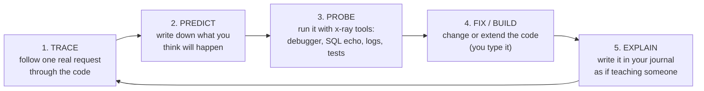

# The Miwa Method: Finish the Project *and* Own What You Built

> A learning method made for this codebase. It is not a generic "learn FastAPI" plan.
> Every exercise points at real files in `app/`, and the real bugs and design weak spots in this repo are used as teaching material.

---

## 0. Why it got hard (the diagnosis)

Before choosing a new method, it helps to know why the old one stopped working. From the code, the git history and `miwa_roadmap_v5.txt`:

| Symptom | Root cause |
|---|---|
| "I can't keep track of what's going on anymore" | The roadmap had you build **layer by layer** (models → schemas → services → routes → ws). But a program *runs* **request by request**. You never built a picture of the runtime path, only of the folder tree. |
| "The abstraction hides things from me" | FastAPI, SQLAlchemy and asyncio all do a lot of work *implicitly* (`Depends`, `yield`, the unit of work, the event loop). You learned the **syntax that triggers the magic**, not the magic itself. |
| "I partially remember what I learned" | The roadmap's OUTCOMEs were checkboxes that got ticked once and never looked at again. Nothing made you **recall** them later, so they faded. |
| Commits like `debugging with gemini` | When the AI writes or fixes code you can't predict, you end up holding code you don't own. Every time that happens the gap between "the code" and "your mental model" grows. |
| No `tests/`, no `requirements.txt` | There's **no feedback loop**. The only way to check your understanding is to run the whole app and click around, which is slow and gives vague results. Slow feedback means slow learning. |

So the new method has to:
1. move you from *layer thinking* to *execution thinking*,
2. lift the hood off each framework at least once,
3. give you fast feedback (tests, logs, a debugger),
4. make you recall things on purpose,
5. **use finishing Miwa as the vehicle** rather than treating it as a separate goal.

---

## 1. The core loop: T-P-P-F-E

Every learning session, whatever the topic, runs this loop:

| Step | What you actually do | Why it works |
|---|---|---|
| **Trace** | Choose *one* user action (e.g. "player logs in") and follow it file by file, line by line, from the HTTP request to the DB and back. | Builds the execution model you're missing. |
| **Predict** | Before running anything, write in your journal: *"I expect 3 SQL queries, the first a SELECT on players…"* | A wrong prediction is the most useful thing that can happen. It shows exactly where your model is broken. |
| **Probe** | Run it with the tools from section 2 and compare against the prediction. | Makes the hidden machinery visible. |
| **Fix / Build** | Make the change: fix a case file (section 5) or build the next feature. **You type every line.** | You own code you wrote and can predict. |
| **Explain** | 5–10 lines in `docs/learn/journal.md`: what happened, what surprised you, one question that's still open. | Writing it down (the Feynman technique) and recalling it later is what makes knowledge stick. |

**Session size:** 90–120 min, matching your old "Block B". One loop per session. A loop done properly beats three done in a hurry.

---

## 2. One-time setup: your x-ray glasses (do this first, about 1 session)

You can't learn what you can't see. Set these up once and they'll pay off in every session afterwards.

1. **SQL echo**: in `app/database.py`, temporarily use `create_engine(..., echo=True)`. Every SQL statement SQLAlchemy sends will be printed. *This one flag will teach you more SQLAlchemy than any tutorial.*
2. **A real debugger**: run uvicorn under the VS Code debugger (`"module": "uvicorn", "args": ["app.main:app", "--reload"]`). Put a breakpoint in `get_current_player` and look at the call stack. You'll see Starlette and FastAPI frames *above* your code. That stack is the "framework" made visible.
3. **`curl -v`**: use it next to `/docs`. The `-v` flag shows raw HTTP headers, including `Set-Cookie` and `Cookie`. Swagger hides those.
4. **`psql` / Supabase SQL editor**: after every action, look at the actual rows. Get used to asking "what is in the DB right now?"
5. **pytest + `TestClient`**: create `tests/` and `requirements.txt` (`pip freeze > requirements.txt`). Your first test is a single line that hits `/health`. Use a **separate test database** (a local SQLite or Postgres DB) so tests never touch Supabase.
6. **Logging instead of print**: `import logging; log = logging.getLogger(__name__)`. You'll need it for the async parts, where print order gets confusing.

---

## 3. Phase A: Map the territory (week 1, about 4 sessions)

Goal: rebuild your mental model of **what already exists** before you add anything.

### A1. Draw the System Map by hand (on paper, not with AI)
One page. Boxes: Browser, `routes/*`, `services/*`, `models/*`, Postgres, plus the **in-memory objects** that live in `app.state`: `pool`, `room_manager`, `global_manager`, `active_games`. Draw arrows for *who calls whom* and *who holds a reference to whom*.

> [!IMPORTANT]
> Mark **two kinds of state** in different colors: state that **survives a restart** (Postgres) and state that **dies on restart** (`app.state.*`). Half the architecture questions in this project come down to that line.

### A2. Trace the 5 golden paths
Write each one as a numbered list of `file:function` steps in `docs/learn/traces.md`:

1. `POST /api/register`: `routes/auth.py` → `AuthService.register` → `Hasher` → `Player` → commit
2. `POST /api/login` + `GET /api/user/me`: cookie set → cookie read in `core/dependencies.py`
3. `POST /api/matchmaking/join` → `MatchmakingPool.enqueue` → background loop in `run_mm_service.py` → `GlobalManager.notify_match_found`
4. `/ws/match/{id}/{pid}` `join_match` ×2 → `GameService.__init__` → `start_question` → `_question_timer`
5. `submit_answer` ×2 → `handle_answer` → `_resolve_question` → … → `_end_match`

For each step, answer: *Which object exists here? Where did it come from? Who else can see it?*

### A3. Find the questions you can't answer yet
While tracing you'll hit lines you can't fully explain. **Don't look them up yet.** Collect them in `docs/learn/questions.md`. Examples you'll probably hit:
- Why does `get_db` in `database.py` use `yield` and not `return`? Who calls `next()` on it?
- `Depends(get_current_player)` itself depends on `Depends(get_db)`. Is that the **same** DB session or two different ones?
- `Column(Integer)` on a class: how does `player.elo` end up returning an `int` and not a `Column`?
- Why are some routes `def` and others `async def`? What would change if you swapped them?
- `GameService.questions` holds ORM objects, but the session that loaded them is closed. Why does `question.body` still work?

That list becomes your curriculum for Phase B. You'll be learning things *you* actually need, in the order you need them.

---

## 4. Phase B: Under the hood (weeks 2–5)

Each module has the same 4 parts:

- **Micro-lab**: build a *tiny* version of the thing **outside Miwa** (in a `labs/` folder, gitignored or separate repo). 30–80 lines. No frameworks if possible. That's how you see what the framework does for you.
- **Miwa probe**: questions about specific lines in this repo.
- **Miwa task**: a real piece of finishing work that needs the concept. (This is how the project gets done.)
- **Exit ticket**: explain it out loud or in writing *without notes*. If you can't, the module isn't done.

### B1. The Python you need before the frameworks make sense
The frameworks are built on these features. You know OOP and functions, but probably not these at depth:

| Feature | Where it's hiding in Miwa | Micro-lab |
|---|---|---|
| Decorators | `@router.get(...)`, `@staticmethod`, `@asynccontextmanager` | Write your own `@route("/path")` decorator that saves functions in a dict, then a 10-line "router" that dispatches strings to them. *You just built the core of APIRouter.* |
| Generators & `yield` | `get_db()`, `lifespan()` | Write a generator, drive it by hand with `next()`, and see where `finally` runs. Then turn it into a context manager. |
| Context managers | `with Session(engine) as db:` | Write a class with `__enter__`/`__exit__` that prints "BEGIN"/"COMMIT"/"ROLLBACK". |
| Descriptors / metaclasses (light) | `id = Column(...)` on models | Write a tiny `Field` descriptor with `__get__`/`__set__`. This is how class attributes turn into per-instance values. |
| Type hints at runtime | `user_data: UserRegister`, `session_id: str = Cookie(None)` | Use `inspect.signature(func)` to read a function's parameters and annotations. **That is exactly how FastAPI decides what to inject.** |
| `async`/`await` | everything in `ws.py`, `game_service.py` | See B5. |

**Exit ticket:** "Explain, without FastAPI, how a framework could look at `def login(user_data: LoginRequest, response: Response, db = Depends(get_db))` and know what to pass in."

### B2. The Web from first principles (HTTP, cookies, REST)
- **Micro-lab:** a raw HTTP server with Python's `socket` module (about 40 lines). Read the request text, print it, send back `HTTP/1.1 200 OK\r\nSet-Cookie: x=1\r\n\r\nhi`. Open it in a browser, refresh, and watch the `Cookie:` header come back.
- **Miwa probe:** use `curl -v` on `/api/login` and find `Set-Cookie: session_id=...; HttpOnly`. What does `HttpOnly` protect against? Which attributes are *missing* (`Secure`, `SameSite`, `Max-Age`)? What happens to that cookie when your frontend runs on a different port (CORS + credentials)?
- **Miwa task:** write `docs/api.md` with method, path, auth, status codes and body for every endpoint. Fix the status-code mistakes you find along the way (see Case File 4).
- **Exit ticket:** "What is a session cookie, where does it live, and what exactly does the server do with it on each request in Miwa?"

### B3. FastAPI under the hood
FastAPI = **Starlette** (ASGI web toolkit) + **Pydantic** (validation) + **dependency injection** that reads your type hints.

- **Micro-lab 1, raw ASGI:** write `async def app(scope, receive, send)` by hand and run it with `uvicorn lab:app`. No FastAPI. Return JSON. *Now you know what uvicorn actually calls.*
- **Micro-lab 2, mini-DI:** a 30-line `solve(func)` that uses `inspect.signature` and recursively resolves `Depends`-like defaults, caching them per request. Compare with your Miwa question "is it the same DB session?" (Answer: FastAPI caches dependencies per request, so yes. Now *prove* it with `id(db)` prints.)
- **Miwa probe:**
  - `lifespan` in `main.py`: what runs before `yield`, what runs after, and when? Why does `Base.metadata.create_all` sit at *import time* outside lifespan, and why is that a problem?
  - `response_model=UserResponse`: what does it *filter*? Now look at `/api/leaderboard`, which has **no** `response_model` and returns ORM `Player` objects… (Case File 1).
  - Where are the request's `Request`, `WebSocket` and `app.state` coming from?
- **Miwa task:** add `response_model`s everywhere, add a `LeaderboardEntry` schema, add CORS middleware for the frontend.
- **Exit ticket:** draw the path from the TCP bytes to your route function: uvicorn → ASGI → Starlette router → FastAPI dependency solver → Pydantic → your function → Pydantic → response.

### B4. SQLAlchemy and databases
Two layers you need to keep apart: **Core** (SQL as Python expressions) and **ORM** (objects mapped to rows, with a *Session* acting as a unit of work).

- **Micro-lab 1, no ORM:** use `sqlite3` from the stdlib. Create a `players` table, insert, select, and **join** with a `matches` table using raw SQL. Write the leaderboard query by hand.
- **Micro-lab 2, the Session:** with `echo=True`, create a Player, change `elo` twice, then `commit()`. How many UPDATEs are emitted? (Learn: *unit of work*, *flush*, *identity map*.) Then access an attribute after `commit()` and watch a new SELECT appear (*expire_on_commit*).
- **Miwa probe:**
  - Your models have **no `ForeignKey` and no `relationship()`**. `Match.player1_id` is just an `Integer`. What stops a match pointing to a player who doesn't exist? What happens to a player's sessions and matches in `delete_user`?
  - `Match.player2_id` vs `Match.player2_bot_id`: which one does `switch_to_bot` fill in? (Case File 2.)
  - `db.query(...)` is the legacy 1.x style, while `select(...)` + `db.execute` is the 2.0 style. You use both. Pick one.
  - `NullPool`: why might Supabase need it, and what does it cost you per request?
- **Miwa task:**
  1. Add **Alembic** and replace `create_all` with migrations. (This is how real teams change schemas.)
  2. Add `ForeignKey`s + `relationship()`s (`Player.matches`, `Match.player1`, `SessionTable.player`) with sensible `ondelete` rules.
  3. Implement match history for the profile page with a proper query (join or relationship).
- **Exit ticket:** "Explain what happens, SQL by SQL, between `db.add(new_player)` and `db.refresh(new_player)` in `AuthService.register`."

### B5. Async and concurrency (the biggest gap in most backends)
- **Micro-lab 1:** two coroutines that `await asyncio.sleep(1)` run concurrently in about 1s total. Now replace one with `time.sleep(1)`: everything freezes. *That's what blocking the event loop means.*
- **Micro-lab 2:** write a 50-line event loop with generators (`yield` as "await"). Look up David Beazley's talks for inspiration. After this, `async` stops being magic.
- **Micro-lab 3:** `create_task` without keeping a reference, plus `task.cancel()` and `CancelledError`. Where does the exception go if a task crashes and nobody awaits it?
- **Miwa probe:**
  - `run_matchmaking` and `GameService._end_match` / `__init__` use **synchronous** `with Session(engine)` inside **async** code. During that DB round-trip to Supabase, what happens to every other player's websocket? (Case File 5.)
  - `_question_timer` calls `handle_answer`, which calls `_resolve_question`, which calls `start_question`, which **cancels `self.question_timer_task`**. That's the task you're currently running inside. Trace it carefully. What exactly happens? (Case File 6.)
  - Two `submit_answer` messages arrive at nearly the same time. Can `_resolve_question` run twice? Why or why not? (Hint: where are the `await` points? Code between two awaits is atomic in asyncio.)
- **Miwa task:** move blocking DB work out of the loop (`await asyncio.to_thread(...)`, or use a single small sync helper) and keep references to background tasks.
- **Exit ticket:** "What is the event loop, what does `await` give up, and why is `time.sleep` inside `async def` a bug?"

### B6. WebSockets and designing a real-time protocol
- **Micro-lab:** a 2-client chat with FastAPI websockets. Then kill one client with Ctrl+C and watch what the server sees.
- **Miwa probe:**
  - `/ws/match/{match_id}/{player_id}`: the player ID comes **from the URL**, and no cookie is checked. Who can connect as player 7? (Case File 3.)
  - When a player disconnects mid-match, `room_manager.disconnect` runs. Does the `GameService` know? Does the match ever end? Does the player's `IN_PROGRESS` match block them from matchmaking forever? (Case File 7.)
- **Miwa task:** write `docs/websocket_protocol.md` **as a state machine** (states: `WAITING_FOR_PLAYERS → QUESTION_ACTIVE → RESOLVING → … → ENDED`, plus `ABANDONED`). Then make the code match the diagram. A state machine is the right tool for game logic and will tidy up `GameService` considerably.
- **Exit ticket:** draw the full sequence diagram for one PvP question, including the timer path.

### B7. Testing as a learning tool
Tests aren't just for catching bugs. A test is a **prediction you write down and the computer checks**, which makes it step 2 of the loop, automated.

- Start with **characterization tests**: tests that pin down what the code *currently* does, even when that behavior is wrong. Then you can refactor without fear.
- Pure logic first (no DB, no network): `EloService.calculate_new_ratings`, `MatchmakingPool.try_pair`, `GameService._determine_result`. These are easy wins.
- Then API tests with `TestClient` + `app.dependency_overrides[get_db]` pointing at a test DB. **`dependency_overrides` only clicks once you understand B3.** That's on purpose.
- Then WebSocket tests: `with client.websocket_connect("/ws/...") as ws:`.
- **Rule from now on:** every Case File fix starts with a **failing test** that reproduces the bug.

### B8. Architecture: the "why" behind the folders
Read these in Miwa and write an ADR (architecture decision record, half a page) for each one:

1. **Where should `HTTPException` live?** It's raised inside `AuthService`, so your service layer now knows about HTTP. What if a websocket needs `register`? (Learn: domain exceptions vs transport exceptions.)
2. **Fat routes:** `switch_to_bot` and `matchmaking` contain business logic (query, create match, build engine). The roadmap said routes should be thin. Move it into a `MatchService`.
3. **Duplicated logic:** "pick 10 random questions + create Match" appears in `run_mm_service.py` *and* `matches.py`. Extract it.
4. **In-memory state:** `app.state.pool` / `active_games` won't survive a restart and won't work with 2 uvicorn workers. Fine for now? Write down *why* (that's a legitimate decision), and what you'd change later (e.g. Redis).
5. **`GameService` takes `app` everywhere:** that's hidden coupling. Could it receive `room_manager` in `__init__` instead? (Learn: dependency injection by hand. It also makes testing much easier.)

These ADRs **double as your OOP coursework design section** from the roadmap.

### B9. Frontend (TypeScript): the other side of the protocol
Once the protocol doc (B6) and API doc (B2) exist, the frontend is mostly "implement the docs". Build it **page by page, each one a vertical slice**: login page → verify cookie → home → matchmaking → battle. Learn `fetch` with `credentials: "include"`, the browser `WebSocket` API, and DOM updates. Keep a tiny state object per page. No framework yet, as your `miwaFrontend.md` already suggests.

### B10. Shipping
Env vars for everything (`.env.example`), pinned `requirements.txt`, deploy to Render/Railway, then put the public URL in the README. Learn: what a process manager does, why `--workers 2` would break your in-memory `active_games` (ties back to B8.4).

---

## 5. Case Files: real issues in your code

These are real problems I found while reading `app/`. **Don't read the answers right away.** Each one has a hint ladder: try the symptom first, then hint 1, then hint 2, and only open the answer when you're stuck. For each case: write a failing test → fix → journal entry.

> [!NOTE]
> Treat them as detective work, not as a list of failures. Every serious codebase has a list like this, and finding them yourself is the skill.

**Case File 1: The leaderboard says too much** *(B3)*
Symptom: call `GET /api/leaderboard` and read the whole response carefully.

Hint 1
Compare that route with <code>GET /api/user/{id}</code>. What does one have in its decorator that the other lacks?

Answer
No <code>response_model</code>, so FastAPI serializes the whole ORM <code>Player</code>, <b>including <code>password_hash</code></b> and email. <code>GET /api/match/{id}</code> and <code>join-invite</code> also return raw ORM objects. Fix: a <code>LeaderboardEntry</code> schema + <code>response_model=list[LeaderboardEntry]</code>.

**Case File 2: Who is player 2 in a bot match?** *(B4, B5)*
Symptom: start a bot match and finish it. Then check the players table.

Hint 1
Look at what <code>switch_to_bot</code> stores in <code>player2_id</code>, and which table <code>_end_match</code> uses to look up <code>player2_id</code>.

Hint 2
What if the bot's id is 1 and the human's id is also 1? Look at <code>self.scores = {player1_id: 0, player2_id: 0}</code>.

Answer
The bot's id goes into <code>player2_id</code> (meant for <b>players</b>), while <code>player2_bot_id</code> stays empty. <code>_end_match</code> then loads a <i>Player</i> with the bot's id, which could be some random real user or <code>None</code>. If the ids collide, the dict keys merge, <code>len(answers_this_round) == 2</code> never becomes true, and the game stalls until the timer. Also, a bot match is saved as <code>RANKED</code>, and a draw against a bot counts as a win. Fix: use <code>player2_bot_id</code>, give the bot a sentinel id inside <code>GameService</code> (e.g. <code>-bot.id</code>), use mode <code>PRACTICE</code> or a new <code>BOT</code> mode.

**Case File 3: Anyone can be anyone on WebSockets** *(B2, B6)*
Symptom: without logging in, open `websocat ws://localhost:8000/ws/lobby/1`.

Hint
Where does <code>player_id</code> come from in <code>ws.py</code>? Is <code>session_id</code> checked anywhere?

Answer
The identity comes from the URL, not the cookie. Fix: read <code>websocket.cookies.get("session_id")</code>, resolve the player the same way <code>get_current_player</code> does, close with code 1008 if invalid, and drop <code>player_id</code> from the path. Also check that the player actually belongs to <code>match_id</code>.

**Case File 4: Wrong status codes and a schema that lies** *(B2, B3)*
Symptom: try updating someone else's account. Then try `PUT /api/user/{your_id}` with an empty body `{}`.

Answer
<code>update_user</code> and <code>delete_user</code> return <b>404</b> for "not authorized" when it should be <b>403</b>. In <code>UserUpdate</code>, <code>Optional[str] = Field(min_length=...)</code> has no default, so the field is still <b>required</b>. You need <code>Field(default=None, ...)</code>. Login also says "username doesn't exist" vs "wrong password", which lets an attacker find out which usernames exist.

**Case File 5: The frozen arena** *(B5)*
Symptom: with two matches running, add `time.sleep(3)` inside `_end_match` to simulate a slow DB. What happens to the *other* match?

Answer
Sync SQLAlchemy calls inside <code>async def</code> block the single event loop, so every websocket, timer and matchmaking tick stops during each round-trip to Supabase. <code>GameService.__init__</code> (called from a websocket handler) and <code>run_matchmaking</code> have the same problem. Fix: <code>await asyncio.to_thread(sync_fn)</code> for DB work, or move to async SQLAlchemy later.

**Case File 6: The timer that cancels itself** *(B5)*
Symptom: in a bot or PvP match, let *both* players time out on question 1. Does question 2 get a working timer?

Hint
Trace the call stack: <code>_question_timer → handle_answer → _resolve_question → start_question → self.question_timer_task.cancel()</code>. Which task is <code>self.question_timer_task</code> at that moment?

Answer
The timer task cancels <i>itself</i>, and the cancellation lands at its next <code>await</code>, which is inside the broadcast/start of the next question. Depending on timing that can kill the new question's setup halfway. Fix: inside the timer, don't call the full chain directly. Set <code>self.question_timer_task = None</code> before resolving, or have the timer only signal (e.g. an <code>asyncio.Event</code>) and let a single game-loop coroutine drive the questions. That's the state-machine redesign from B6.

**Case File 7: The match that never ends** *(B6)*
Symptom: start a PvP match, close one browser tab, then try to join matchmaking again with that user.

Answer
Disconnecting removes the socket but doesn't tell the <code>GameService</code>. The other player keeps receiving questions against nobody, the match stays <code>IN_PROGRESS</code> in the DB forever, and the 2nd guard in <code>/api/matchmaking/join</code> blocks that user <b>permanently</b>. Also, <code>submit_answer</code> on a match with no game raises <code>KeyError</code> and kills the socket. Fix: an <code>ABANDONED</code> state, a reconnection grace period, and a forfeit.

**Case File 8: The queue's front-door problem** *(DAA + B7)*
Symptom: queue A (math, elo 100), B (grammar, elo 500), C (grammar, elo 500). Do B and C get paired?

Answer
<code>try_pair</code> only compares <code>q[0]</code> against the others. If A can't be matched, nobody behind A is ever compared with each other. Fix: compare all pairs (O(n²) is fine for small n), or bucket by category first. Write the test first, then fix it. It's a nice DAA exercise.

**More to find on your own** (no answers given): what happens to `create_task` results nobody holds a reference to? What happens if `questions_data` has fewer than 10 ids because a category has few questions? What happens if a category has **zero**? Is `asyncio.get_event_loop()` the recommended call inside a coroutine? What happens in `try_pair` if the same player is in the queue twice?

---

## 6. Phase C: Finish Miwa (weeks 5–9, overlaps with Phase B)

Here are the unchecked README items, each paired with the module that teaches what you need for it. **Each feature is a vertical slice: test → backend → protocol doc → frontend → journal.**

| Remaining work | Learn it in | Done when |
|---|---|---|
| Secure WS auth + fix bot match ids | B3, B6, Case 2 & 3 | Tests prove an unauthenticated socket is rejected |
| Disconnect / abandon handling | B5, B6, Case 6 & 7 | Closing a tab ends the match cleanly for the other player |
| `docs/websocket_protocol.md` as a state machine | B6 | Every event has sender, payload, next state |
| Practice mode (no ELO) | B8 (refactor `_end_match` first) | One `_end_match` path, with the result strategy chosen by mode |
| Invite mode over WebSockets | B6 | Two browsers play a full invite match |
| Deterministic ghost fallback + seeding script | B4 (queries over `answers_data`) | Script reads historical matches and fills `performance_data` |
| Alembic + FKs + relationships + match history | B4 | `alembic upgrade head` builds the schema from zero |
| Frontend: login → home → matchmaking → battle → leaderboard/profile | B9 | A full match playable in the browser |
| Env config, CORS, `requirements.txt`, deploy | B3, B10 | Public URL in README |
| Error-handling audit + structured logging | B2, B7 | No unhandled 500s in tests |
| Coursework report / CONTRIBUTING | B8 ADRs | A stranger can add a new question category from the doc alone |

> [!TIP]
> **Refactor before you extend.** Adding Practice and Invite to the current `_end_match` (bot branch, draw branch, win/lose branch, each with copy-pasted send code) will make it unreadable. Write characterization tests, *then* restructure it (e.g. a small `MatchResult` object + one `_apply_result(mode)` + one `_notify(result)`), *then* add modes.

---

## 7. Weekly rhythm

Same Mon–Fri / free-weekend structure as your roadmap, which works for you:

| Day | Session type |
|---|---|
| Mon | **New concept**: micro-lab for the module (outside Miwa) |
| Tue | **Probe**: answer the module's Miwa probe questions with debugger / echo / tests |
| Wed | **Build**: Miwa task or Case File (failing test first) |
| Thu | **Build**: continue, then refactor what you wrote yesterday |
| Fri | **Consolidate**: retrieval quiz (see below), update System Map + journal, write one ADR, push |

**Friday retrieval quiz (15 min, closed book):** pick 5 questions from `docs/learn/questions.md` you've already answered, *including ones from earlier weeks*, and answer them from memory. Mark the ones you got wrong and they come back next Friday. (This is spaced repetition. It's the single most effective technique for actually remembering things.)

**Monthly "blank page" test:** without looking at the code, rewrite `get_current_player` or `RoomManager.broadcast` from memory in a scratch file, then diff it against the real one.

---

## 8. Rules for working with AI (including me)

The AI isn't the problem. The problem is *which role* it plays. Use it as a tutor and a reviewer, not as the author.

1. **No paste rule:** you type every line that goes into `app/`. If AI shows you code, close it and re-type it from understanding. If you can't, you didn't understand it yet. That's the signal to ask another question.
2. **Ask for questions, not answers:** "Don't tell me the bug. Ask me questions that lead me to it." "Quiz me on SQLAlchemy sessions." "Here's my explanation of `Depends`. What's wrong or missing?"
3. **Predict before you ask:** write your guess first, then ask. Compare.
4. **Review mode:** after *you* write a feature, ask AI to review it like a strict senior engineer. Then decide yourself which comments to accept, and say why in the commit message.
5. **Explain-back:** after any AI explanation, write 3 lines in your own words in the journal. If you can't, ask again, differently.
6. **Commit hygiene:** never commit code you can't explain line by line. Git is your audit trail of understanding. Make commit messages say what you *learned*, not just what changed.

---

## 9. What you'll produce (learning artifacts = portfolio)

All under `docs/learn/` (or `docs/`). These are proof of skill for Erasmus professors, not just notes.

- `journal.md`: dated T-P-P-F-E entries
- `traces.md`: the 5 golden paths (keep them updated as code changes)
- `questions.md`: your question bank, with answers, used for Friday quizzes
- `system_map.png`: photo of your hand-drawn map, redrawn monthly
- `adr/0001-*.md` …: architecture decisions
- `websocket_protocol.md`, `api.md`: the contracts
- `case_files.md`: each bug found: symptom → root cause → test → fix → lesson
- `labs/`: the micro-labs (raw HTTP server, raw ASGI app, mini-DI, mini event loop, sqlite3 joins)

---

## 10. How you'll know it worked (self-check rubric)

You've **learned** this project, not just built it, when you can do each of these without notes:

- [ ] Draw the request path from browser to Postgres and back for any endpoint
- [ ] Explain how FastAPI decides what to inject into a route function, and when dependencies are created and cleaned up
- [ ] Predict the SQL that a block of ORM code will emit (check with `echo=True`)
- [ ] Explain what blocks the event loop and why it matters for a multiplayer game
- [ ] Explain what state lives in memory vs in the DB and what breaks on restart / with 2 workers
- [ ] Add a new WebSocket event end to end (constant → handler → protocol doc → test → frontend) in one session
- [ ] Write a failing test for a bug before fixing it
- [ ] Justify each folder (`models/schemas/services/routes/core`) and point to one place where the code breaks that rule
- [ ] Rebuild a 50-line micro-version of FastAPI-style routing + DI from scratch

---

### Suggested first 5 sessions (to get moving tomorrow)

1. Setup x-ray glasses (§2): `echo=True`, debugger, `tests/test_health.py`, `requirements.txt`.
2. Hand-draw the System Map (§A1). Trace golden path #2 (login + `/me`) with the debugger, step by step.
3. Micro-lab B1: your own `@route` decorator + `inspect.signature` injection.
4. Case File 1: failing test → `response_model` fix → journal.
5. Friday: retrieval quiz on sessions 1–4, write ADR-0001 ("Why routes call services").
